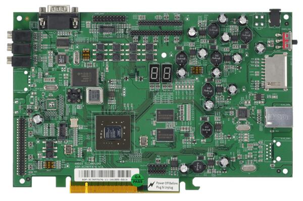
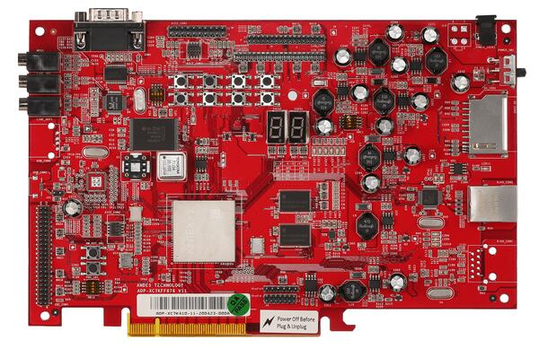
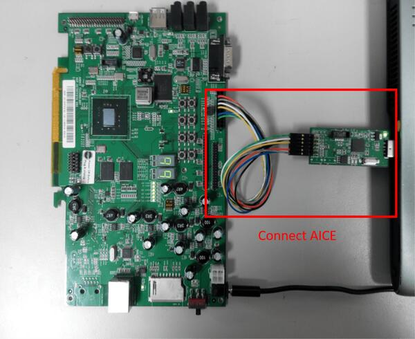

.. zephyr:board:: adp_xc7k

Overview
********

ADP-XC7K AE350 board is for AndeShape AE350 platform on ADP-XC7K series
FPGA-based development boards.

ADP-XC7K series are FPGA-based development and prototyping boards for evaluation of
variety of AndesCore processors and AndeShape SoC platform IPs.
AE350 is a RISC-V platform which can integrate AndesCore CPUs with a collection
of fundamental peripheral IPs.

1st figure shows the green PCB is ADP-XC7K160 and 2nd figure shows the red PCB is ADP-XC7K410.

More information can be found on `ADP-XC7K160/410`_ and `AndeShape AE350`_ websites.

Hardware
********

The ADP-XC7K AE350 platform integrates 1 ~ 4 cores 32/64-bit 60MHz RISC-V CPUs, DSP,
1GB RAM, Cache, SPI flash memory, ethernet controller and other peripherals.

The ADP-XC7K AE350 platform provides following hardware components:

- 1 ~ 4 cores 32/64-bit 60MHz AndeStar v5 RISC-V CPUs
- 1GB on-board SDRAM
- 2MB SPI flash memory (1MB can be used for XIP)
- UART
- I2C
- SPI
- GPIO
- PWM
- DMA
- 10/100 Ethernet RJ45 port
- LCD module connector
- 16KB I2C EEPROM
- SD memory card slot
- MIC-in, Line-in, and Line-out with AC97 audio codec

Supported Features
==================

.. zephyr:board-supported-hw::

Connections and IOs
===================

The ADP-XC7K AE350 platform has 1 GPIO controller. It providing 32 bits of IO.
It is responsible for pin input/output, pull-up, etc.

Mapping from GPIO controller to the ADP-XC7K board pins:

+--------------------+--------------------+
| GPIO controller    | Usage / Board pins |
+====================+====================+
| **Push Buttons**   |                    |
+--------------------+--------------------+
| GPIO.0             | SW1                |
+--------------------+--------------------+
| GPIO.1             | SW2                |
+--------------------+--------------------+
| GPIO.2             | SW3                |
+--------------------+--------------------+
| GPIO.3             | SW4                |
+--------------------+--------------------+
| GPIO.4             | SW5                |
+--------------------+--------------------+
| GPIO.5             | SW6                |
+--------------------+--------------------+
| GPIO.6             | SW7                |
+--------------------+--------------------+
| **7-Segment LED1** |                    |
+--------------------+--------------------+
| GPIO.16            | 7SEG1.A            |
+--------------------+--------------------+
| GPIO.17            | 7SEG1.B            |
+--------------------+--------------------+
| GPIO.18            | 7SEG1.C            |
+--------------------+--------------------+
| GPIO.19            | 7SEG1.D            |
+--------------------+--------------------+
| GPIO.20            | 7SEG1.E            |
+--------------------+--------------------+
| GPIO.21            | 7SEG1.F            |
+--------------------+--------------------+
| GPIO.22            | 7SEG1.G            |
+--------------------+--------------------+
| GPIO.23            | 7SEG1.DP           |
+--------------------+--------------------+
| **7-Segment LED2** |                    |
+--------------------+--------------------+
| GPIO.24            | 7SEG2.A            |
+--------------------+--------------------+
| GPIO.25            | 7SEG2.B            |
+--------------------+--------------------+
| GPIO.26            | 7SEG2.C            |
+--------------------+--------------------+
| GPIO.27            | 7SEG2.D            |
+--------------------+--------------------+
| GPIO.28            | 7SEG2.E            |
+--------------------+--------------------+
| GPIO.29            | 7SEG2.F            |
+--------------------+--------------------+
| GPIO.30            | 7SEG2.G            |
+--------------------+--------------------+
| GPIO.31            | 7SEG2.DP           |
+--------------------+--------------------+
| **GPIO pins**      |                    |
+--------------------+--------------------+
| GPIO.7             | IDE_CON1.4         |
+--------------------+--------------------+
| GPIO.8             | IDE_CON1.6         |
+--------------------+--------------------+
| GPIO.9             | IDE_CON1.8         |
+--------------------+--------------------+
| GPIO.10            | IDE_CON1.10        |
+--------------------+--------------------+
| GPIO.11            | IDE_CON1.11        |
+--------------------+--------------------+
| GPIO.12            | IDE_CON1.12        |
+--------------------+--------------------+
| GPIO.13            | IDE_CON1.13        |
+--------------------+--------------------+
| GPIO.14            | IDE_CON1.14        |
+--------------------+--------------------+
| GPIO.15            | IDE_CON1.15        |
+--------------------+--------------------+

Other peripheral mapping are listed below:

+-------------+---------------------------------+
| Peripherals | Usage / Board pins              |
+=============+=================================+
| SPI_1       | internal connected to SPI Flash |
+-------------+---------------------------------+
| SPI_2_CS    | IDE_CON1.37                     |
+-------------+---------------------------------+
| SPI_2_MOSI  | IDE_CON1.36                     |
+-------------+---------------------------------+
| SPI_2_MISO  | IDE_CON1.38                     |
+-------------+---------------------------------+
| SPI_2_SCLK  | IDE_CON1.35                     |
+-------------+---------------------------------+
| I2C_SDA     | J27.1                           |
+-------------+---------------------------------+
| I2C_SCL     | J27.2                           |
+-------------+---------------------------------+

System Clock
------------

The ADP-XC7K AE350 platform has 60MHz core clock.

Serial Port
-----------

The ADP-XC7K AE350 platform has 2 UARTs.
The Zephyr console output is by default assigned to UART2 and the default
settings are 115200 8N1.

Programming and debugging
*************************

.. zephyr:board-supported-runners::

Applications for the ``adp_xc7k`` board can be built, flashed and debugged in
the usual way (see :ref:`build_an_application` and :ref:`application_run` for
more details). Flashing and debugging require an Andes ICE (AICE) and the
Andes ICE management software, ICEman.

Connecting Andes ICE (AICE)
===========================

AICE is used for flashing and debugging the board. Please connect AICE to both
ADP-XC7K board and the host computer as shown in the figure.

More information can be found on `AICE-MINI+`_, `AICE-MICRO`_ website

Configuring a Console
=====================

The Zephyr console is on UART2. Use the following settings with your serial
terminal of choice (minicom, putty, etc.):

- Speed: 115200
- Data: 8 bits
- Parity: None
- Stop bits: 1

Flashing
========

The board is configured to be flashed with the ``andes-iceman`` runner. Download
ICEman (``ice.zip``) from the `Andes Development Kit`_. To program the SPI flash,
you also need the SPI flash burner ``SPI_burn`` from ``flash.zip``. Add both to
``PATH``, or pass their paths with ``--iceman`` and ``--spi-burn``.

.. note::

   To run ICEman commands as a normal user, you will need to install the
   :file:`70-ndsusb-v1.rules` udev rules file (usually by placing it in
   :file:`/etc/udev/rules.d`, then unplugging and plugging the
   AICE adapter in again via USB.).

The runner programs the image depending on where it runs:

- RAM or ILM (Instruction Local Memory): the runner loads ``zephyr.elf`` with GDB.
- XIP on the SPI flash: the runner programs ``zephyr.bin`` into the SPI flash
  with ``SPI_burn``.

ICEman can run on the local host or on a remote host.

Local ICEman
------------

By default, the runner starts ICEman on the host the AICE is connected to, and
stops it when done:

.. zephyr-app-commands::
   :zephyr-app: samples/hello_world
   :board: adp_xc7k/ae350_a25
   :goals: build flash

You should see the following message on the console:

.. code-block:: console

   *** Booting Zephyr OS build vX.Y.Z ***
   Hello World! adp_xc7k/ae350_a25

Remote ICEman
-------------

The runner can also connect to an ICEman already running on another host, for
example a host shared by several users. ICEman is a server and reports the
ports it listens on when it starts:

.. code-block:: console

   $ ./ICEman
   ...
   Burner listens on 2354
   Telnet port: 4444
   ...
   The core #0 listens on 1111.
   ICEman is ready to use.

Pass the host name or IP address of the ICEman with ``--iceman-host``, and the
ports from the ICEman output with these options:

- ``--burner-port``: the port in ``Burner listens on 2354``. ``SPI_burn``
  connects to it as a client to program the SPI flash.
- ``--telnet-port``: the port in ``Telnet port: 4444``. The runner connects to
  it to send commands, which could reset the target.
- ``--gdb-port``: the port in ``The core #0 listens on 1111``. GDB connects to
  it to load and debug the image.

ICEman is not needed on the local host, but ``SPI_burn`` still is to program the
SPI flash.

.. zephyr-app-commands::
   :zephyr-app: samples/hello_world
   :board: adp_xc7k/ae350_a25
   :goals: build flash
   :flash-args: --iceman-host <host> --telnet-port <port> --gdb-port <port> --burner-port <port>

Debugging
=========

You can debug an application in the usual way. Here is an example for the
:zephyr:code-sample:`hello_world` application.

.. zephyr-app-commands::
   :zephyr-app: samples/hello_world
   :board: adp_xc7k/ae350_a25
   :maybe-skip-config:
   :goals: debug

For a remote ICEman, pass the same options as for flashing.

References
**********

.. target-notes::

.. _ADP-XC7K160/410: http://www.andestech.com/en/products-solutions/andeshape-platforms/adp-xc7k160-410/

.. _AndeShape AE350: http://www.andestech.com/en/products-solutions/andeshape-platforms/ae350-axi-based-platform-pre-integrated-with-n25f-nx25f-a25-ax25/

.. _AICE-MINI+: http://www.andestech.com/en/products-solutions/andeshape-platforms/aice-mini-plus/

.. _AICE-MICRO: http://www.andestech.com/en/products-solutions/andeshape-platforms/aice-micro/

.. _Andes Development Kit: https://github.com/andestech/Andes-Development-Kit/releases
