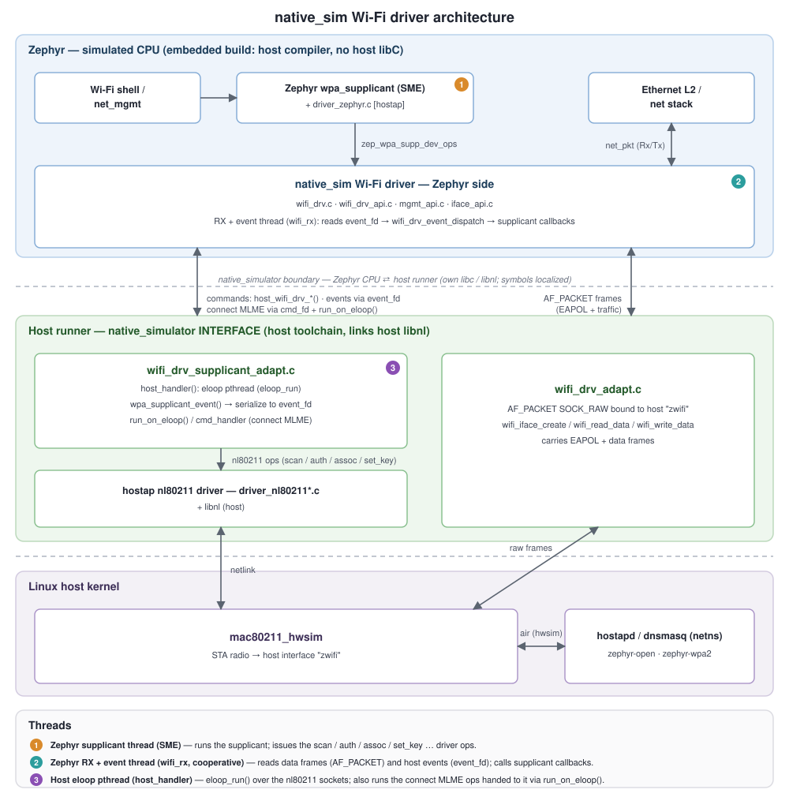

.. _nsim_per_intc:

Interrupt controller
====================

A simple yet generic interrupt controller is provided. It can nest interrupts
and provides interrupt priorities. Interrupts can be individually masked or
unmasked. SW interrupts are also supported.

.. _nsim_per_timer:

Clock, timer and system tick model
==================================

This model provides the system tick timer. By default
:kconfig:option:`CONFIG_SYS_CLOCK_TICKS_PER_SEC` configures it to tick every 10ms.

Please refer to the section :ref:`About time in native_sim <native_sim_about_time>` for more
information.

.. _nsim_per_uart:

UART/Serial
===========

Two optional native UART drivers are available:

**PTY driver (UART_NATIVE_PTY)**
   With this driver, Zephyr UART devices can be created. These
   can be connected to the Linux process stdin/stdout or a newly created
   pseudo-tty. For more information refer to the section `PTY UART`_.

**TTY driver (UART_NATIVE_TTY)**
   An UART driver for interacting with host-attached serial port devices
   (eg. USB to UART dongles). For more information refer to the section
   `TTY UART`_.

.. _native_ptty_uart:

PTY UART
--------

This driver is automatically enabled when devicetree contains nodes with the
``"zephyr,native-pty-uart"`` compatible property and ``okay`` status and
:kconfig:option:`CONFIG_SERIAL` is set.
By default one ready UART of this type is setup in DTS, but any number can be enabled as desired.

Normally these UARTs are connected to new pseudoterminals PTYs, i.e. :file:`/dev/pts{<nbr>}`,
but it is also possible to map one of them to the executable's ``stdin`` and ``stdout``.
This can be done in two ways, either with the command line option ``--<uart_name>_stdinout``
(where ``<uart_name>`` is the UART DTS node name), or, for the first PTY UART instance by choosing
:kconfig:option:`CONFIG_UART_NATIVE_PTY_0_ON_STDINOUT` instead of the default
:kconfig:option:`CONFIG_UART_NATIVE_PTY_0_ON_OWN_PTY`.
For interactive use with the :ref:`shell_api`, it is recommended to choose the PTY option.
The ``STDINOUT`` option can be used for automated testing, such as when piping other processes'
output to control it. This is because the shell subsystem expects access to a raw terminal,
which (by default) a normal Linux terminal is not.

When a UART is connected to a new PTY, the name of the newly created UART pseudo-terminal will be
displayed in the console.
If you want to interact with it manually, you should attach a terminal emulator to it.
This can be done, for example with the command:

.. code-block:: console

   $ xterm -e screen /dev/<ptyn> &
   # Or if you prefer gnome-terminal:
   $ gnome-terminal -- screen /dev/<ptyn> &

where :file:`/dev/{<ptyn>}` should be replaced with the actual PTY device.

You may also chose to automatically attach a terminal emulator to any of these UARTs.
To automatically attach one to all these UARTs, pass the command line option ``-attach_uart`` to the
executable. To automatically attach one to a single UART use ``-<uart_name>_attach_uart``.
The command used for attaching to the new shell can be set for all UARTs with the command line
option ``-attach_uart_cmd=<"cmd">``, or for each individual UART with
``-<uart_name>_attach_uart_cmd``. Where the default command is given by
:kconfig:option:`CONFIG_UART_NATIVE_PTY_AUTOATTACH_DEFAULT_CMD`.
Note that the default command assumes both ``xterm`` and ``screen`` are installed in the system.

Note that these ``uart_cmd`` commands can be effectively any shell command including lists of
commands. Therefore it is possible to invoke any other script or program from it.
Those commands will be run right after the PTY is created.
For example, if one wanted to create a link to the newly created PTY, and have it removed when the
program ends, one could do:

.. code-block:: console

   $ zephyr.exe --uart_attach_uart_cmd='ln -s %s /tmp/somename' ; rm /tmp/somename

This driver supports poll mode, interrupt mode and async mode.
Neither runtime configuration or line control are supported.

.. _native_tty_uart:

TTY UART
--------

With this driver an application can use the polling and interrupt based UART APIs to write and read
characters to and from a connected serial port device.

This driver is automatically enabled when a devicetree contains a node
with ``"zephyr,native-tty-uart"`` compatible property and ``okay`` status, such
as one below.

.. code-block:: dts

   uart {
     status = "okay";
     compatible = "zephyr,native-tty-uart";
     serial-port = "/dev/ttyUSB0";
     current-speed = <115200>;
   };

Interaction with serial ports can be configured in several different ways:

* The default serial port and baud rate can be set via the device tree
  properties ``serial-port`` and ``current-speed`` respectively.  The
  ``serial-port`` property is optional.
* Serial port and baud rate can also be set via command line options ``X_port``
  and ``X_baud`` respectively, where ``X`` is a name of a node. Command line
  options override values from the devicetree.
* When neither ``serial-port`` nor ``X_port`` names the port, the driver can
  find a USB serial adapter by vendor and product ID: the ``usb-ids`` property
  lists ``<vendor-id product-id>`` pairs, tried in order, and the first host tty
  whose USB device matches is opened. The application exits if none matches.
* The ``low-latency`` property asks the host tty driver to deliver received
  data at once instead of after a latency timer, which USB serial adapters such
  as FTDI ones otherwise wait for.
* The rest of the configuration options such as number of data and stop bits,
  parity, as well as baud rate can be set at runtime with ``uart_configure``.
* This driver can emulate an interrupt-driven UART by enabling
  :kconfig:option:`CONFIG_UART_INTERRUPT_DRIVEN`.

Multiple instances of such uart drivers are supported.

The :zephyr:code-sample:`uart-native-tty` sample app provides a working example of the
driver.

This driver only supports poll mode and interrupt mode. Async mode is not
supported.
It has runtime configuration support. With
:kconfig:option:`CONFIG_UART_LINE_CTRL`, :c:func:`uart_line_ctrl_set` drives the
port's DTR and RTS lines.

.. _nsim_per_dmic:

Digital microphone (DMIC)
=========================

A file-backed DMIC driver is available for native_sim. It reads PCM sample
data from a binary file on the host file system and presents it through the
Zephyr DMIC API, which is useful for testing audio capture pipelines.

By default the input file path is taken from
:kconfig:option:`CONFIG_AUDIO_DMIC_NATIVE_SIM_FILE_PATH`. Each DMIC instance
exposes its own command line override in the form
``--<device>_file=<path>``. For the default native_sim instance this is
``--dmic0_file=<path>``.

If the configured host input file does not exist, the driver prints a warning
from the native simulator runner side and provides zeroes (silence).

.. _nsim_per_i2s:

Inter-IC sound (I2S)
====================

An I2S driver which can be configured for RX, TX, or both directions. It
reads or writes PCM sample data through the Zephyr I2S API from or to files
on the host file system or, with :kconfig:option:`CONFIG_I2S_NATIVE_SIM_ALSA`
enabled, ALSA PCM devices on the host. This is useful for testing stream
handling and loopback scenarios, and for playing or capturing real audio.

By default the RX and TX paths are taken from
:kconfig:option:`CONFIG_I2S_NATIVE_SIM_RX_PATH` and
:kconfig:option:`CONFIG_I2S_NATIVE_SIM_TX_PATH`. Each I2S instance
exposes its own command line overrides in the form of
``--<device>_rx=<path>`` and ``--<device>_tx=<path>``. For example, the
default bidirectional native_sim instance uses ``--i2s_rxtx_rx=<path>`` and
``--i2s_rxtx_tx=<path>``.

If an RX input file cannot be opened, the driver prints a warning from the
native simulator runner side and feeds silence for that stream run. If a TX
output file cannot be opened, the driver prints a warning and discards TX
data for that stream run.

With :kconfig:option:`CONFIG_I2S_NATIVE_SIM_ALSA` enabled, a path starting
with ``alsa:`` opens the named ALSA PCM device on the host instead of a file,
and both paths default to ``alsa:default``. Other devices can be selected in
the same way, for example ``--i2s_rxtx_rx=alsa:hw:0,0``. The device is
accessed without blocking and the simulation is slowed down to real time by
default. Word sizes of 8, 16, 24 and 32 bits are supported; 24-bit words are
LSB-justified in 32-bit samples.

This requires the ALSA development library on the host, which has to match
the word size of the image: the 32-bit version for the default ``native_sim``
target and the 64-bit version for :ref:`64bit native_sim<native_sim32_64>`
builds. On a Debian/Ubuntu host ``libasound2-dev`` provides the 64-bit
library; the 32-bit one is installed, and found by ``pkg-config``, with:

.. code-block:: console

   $ sudo dpkg --add-architecture i386
   $ sudo apt update
   $ sudo apt install pkg-config libasound2-dev:i386
   $ export PKG_CONFIG_PATH=/usr/lib/i386-linux-gnu/pkgconfig

.. _nsim_per_rtc:

Real time clock
===============

The real time clock model provides a model of a constantly powered clock.
By default this is initialized to the host time at boot.

This RTC can also be set to start from time 0 with the ``--rtc-reset`` command
line option.

It is possible to offset the RTC clock value at boot with the
``--rtc-offset=<offset>`` option,
or to adjust it dynamically with the function :c:func:`native_rtc_offset`.

After start, this RTC advances with the simulated time, and is therefore
affected by the simulated time speed ratio.
See :ref:`About time in native_sim <native_sim_about_time>` for more information.

The time can be queried with the functions :c:func:`native_rtc_gettime_us`
and :c:func:`native_rtc_gettime`. Both accept as parameter the clock source:

- ``RTC_CLOCK_BOOT``: It counts the simulated time passed since boot.
  It is not subject to offset adjustments
- ``RTC_CLOCK_REALTIME``: RTC persistent time. It is affected by
  offset adjustments.
- ``RTC_CLOCK_PSEUDOHOSTREALTIME``: A version of the real host time,
  as if the host was also affected by the clock speed ratio and offset
  adjustments performed to the simulated clock and this RTC. Normally
  this value will be a couple of hundredths of microseconds ahead of the
  simulated time, depending on the host execution speed.
  This clock source should be used with care, as depending on the actual
  execution speed of native_sim and the host load,
  it may return a value considerably ahead of the simulated time.

Note this device does not yet have an :ref:`RTC API compatible driver <rtc_api>`.

.. _nsim_per_entr:

Entropy device
==============

An entropy device based on the host :c:func:`random` API.
This device will generate the same sequence of random numbers if initialized
with the same random seed.
You can change this random seed value by using the command line option:
:samp:`--seed={<random_seed>}` where the value specified is a 32-bit integer
such as 97229 (decimal),  0x17BCD (hex), or 0275715 (octal).

.. _nsim_per_ethe:

Ethernet driver
===============

A simple TAP based ethernet driver is provided. The driver expects that the
**zeth** network interface already exists in the host system. The **zeth**
network interface can be created by the ``net-setup.sh`` script found in
the `net-tools`_ zephyr project repository. User can communicate with the
Zephyr instance via the **zeth** network interface. Multiple TAP based
network interfaces can be created if needed. The IP address configuration
can be specified for each network interface instance.

Note that this device can only be used with Linux hosts.

.. _`net-tools`: https://github.com/zephyrproject-rtos/net-tools

.. _nsim_per_wifi:

Wi-Fi driver
============

A native_sim Wi-Fi driver is provided which presents a Wi-Fi station
interface in Zephyr backed by a Linux host radio. It runs the Zephyr
wpa_supplicant and drives a simulated Linux ``mac80211_hwsim`` radio through
the host ``nl80211`` interface. The radio is simulated by the Linux kernel,
but the ``nl80211``/``mac80211`` stack driving it is the normal Linux one, so
the scan / connect (open and WPA2-PSK) / disconnect flow can be exercised
entirely on the host.

   native_sim Wi-Fi driver: components, control/data paths and threads.

The driver is built when a node with the ``zephyr,native-sim-wifi`` compatible
is present in the devicetree (add one through a devicetree overlay). The
``host-interface`` property selects the Linux interface the driver binds to,
and the MAC address is taken from the standard ``local-mac-address`` /
``zephyr,random-mac-address`` properties:

.. code-block:: devicetree

   / {
           wifi0: wifi {
                   compatible = "zephyr,native-sim-wifi";
                   host-interface = "zwifi";
                   zephyr,random-mac-address;
           };
   };

Both can also be overridden from the command line with the ``--wifi-if=<name>``
and ``--wifi-mac-addr=<mac>`` options.

The build links the host ``libnl``, which has to match the word size of the
image. The default 32-bit ``native_sim`` target requires the 32-bit ``libnl``
development libraries; on a Debian/Ubuntu host:

.. code-block:: console

   $ sudo dpkg --add-architecture i386
   $ sudo apt update
   $ sudo apt install gcc-multilib pkg-config libnl-3-dev:i386 libnl-genl-3-dev:i386
   $ export PKG_CONFIG_PATH=/usr/lib/i386-linux-gnu/pkgconfig

For :ref:`64bit native_sim<native_sim32_64>` builds the 64-bit version is
needed instead:

.. code-block:: console

   $ sudo apt install pkg-config libnl-3-dev libnl-genl-3-dev

The simulated radio and the access points it connects to are created on the
host with the ``net-setup.sh`` script and the ``zwifi`` configuration from the
`net-tools`_ repository. That setup loads the ``mac80211_hwsim`` kernel
module, creates the ``zwifi`` station interface, and starts ``hostapd`` and
``dnsmasq`` access points, so ``iw``, ``hostapd`` and ``dnsmasq`` must also be
installed. As the binary opens ``AF_PACKET`` and ``nl80211`` sockets,
``zephyr.exe`` must be granted the ``cap_net_raw`` and ``cap_net_admin``
capabilities (e.g. ``sudo setcap cap_net_raw,cap_net_admin+ep zephyr.exe``) or
be run as root.

A complete, runnable example including the host setup (and an optional Docker
wrapper) is provided by the :zephyr_file:`tests/net/wifi/interop` test.

Note that this driver can only be used with Linux hosts.

.. _nsim_per_offloaded_sockets:

Offloaded sockets driver
========================

This driver is an alternative to the :ref:`TAP based ethernet driver
<nsim_per_ethe>`. Instead of using a virtual network in the Linux side, this
driver utilizes Linux's standard BSD socket API. With this, multiple Zephyr
applications can communicate over the Linux loopback interface.
The benefit of this approach is that root privileges are not required and
that the process is connected to the same interface as other Linux processes
instead of a virtual network, facilitating testing without the need for extra
setup in the host. The drawback is that the L2 layer of Zephyr's networking
stack is not exercised.

.. _nsim_bt_host_cont:

Bluetooth controller
====================

It's possible to use the host's Bluetooth adapter as a Bluetooth
controller for Zephyr. To do this the HCI device needs to be passed as
a command line option to ``zephyr.exe``. For example, to use ``hci0``,
use ``sudo zephyr.exe --bt-dev=hci0``. Using the device requires root
privileges (or the CAP_NET_ADMIN POSIX capability, to be exact) so
``zephyr.exe`` needs to be run through ``sudo``. The chosen HCI device
must be powered down and support Bluetooth Low Energy (i.e. support the
Bluetooth specification version 4.0 or greater).

Another possibility is to use a HCI TCP server which acts as a
:ref:`virtual Bluetooth controller<bluetooth_virtual_posix>` over TCP.
To connect to a HCI TCP server its IP address and port number must
be specified. For example, to connect to a HCI TCP server with IP
address 127.0.0.0 and port number 1020 use ``zephyr.exe --bt-dev=127.0.0.1:1020``.
This alternative option is mainly aimed for testing Bluetooth connectivity over
a virtual Bluetooth controller that does not depend on the Linux Bluetooth
stack and its HCI interface.

.. _nsim_per_usb:

USB controller
==============

It's possible to use the Virtual USB controller working over USB/IP
protocol. More information can be found in
:ref:`Testing USB over USP/IP in native_sim <testing_USB_native_sim>`.

.. _nsim_per_disp_sdl:

Display driver
==============

A display driver is provided that creates a window on the host machine to
render display content.

When building for the default 32bit ``native_sim`` target this driver requires a 32-bit version of
the `SDL2`_ development library on the host machine. For
:ref:`64bit native_sim<native_sim32_64>` builds you need to have the 64bit version installed.
You may also need to set ``pkg-config`` to correctly pickup the SDL2 install path.

On Ubuntu the package is ``libsdl2-dev`` whose 64bit version is likely installed by default.
On an Ubuntu 18.04 host system, you can install the ``pkg-config`` and the 32bit
``libsdl2-dev:i386`` packages, and configure the pkg-config search path with these commands:

.. code-block:: console

   $ sudo dpkg --add-architecture i386
   $ sudo apt update
   $ sudo apt-get install pkg-config libsdl2-dev:i386
   $ export PKG_CONFIG_PATH=/usr/lib/i386-linux-gnu/pkgconfig

.. _SDL2:
   https://www.libsdl.org

.. _nsim_per_video_fifo:

Video capture driver
====================

A video capture driver is provided that reads raw frames from a named pipe
(FIFO) on the host, and presents them through the :ref:`video_api` as an
ordinary ``zephyr,camera`` device. This makes it possible to feed an
application with frames coming from a real webcam, a video file, or a
generated test pattern, without any camera hardware.

The device can be instantiated using the :ref:`snippet-video-native-fifo`
snippet, or by adding a devicetree node with the
``zephyr,native-sim-video-fifo`` compatible. The application selects the
pixel format and the frame size, up to 1920x1080, with
:c:func:`video_set_format`. The default is 320x240 RGB565. The host writer
must produce frames of that format, as the driver does no scaling or
conversion. In ``ffmpeg``, RGB565, YUYV and GREY are ``rgb565le``,
``yuyv422`` and ``gray``.

The FIFO path is taken from the ``fifo-path`` devicetree property, and
defaults to ``/tmp/zephyr-<device>-<pid>.fifo``. Each instance exposes its own
command line override in the form ``--<device>=<path>``. For a node named
``video-fifo`` this is ``--video-fifo=<path>``. A FIFO created by the driver
is removed when the simulator exits.

The FIFO is created by the driver when the application starts streaming. A
writer must therefore either create the FIFO itself, for instance with
``mkfifo``, or be started afterwards. For example:

.. code-block:: console

   $ mkfifo /tmp/zephyr-cam.fifo
   $ zephyr.exe --video-fifo=/tmp/zephyr-cam.fifo

Then, from another terminal, feed it a test pattern in the default format:

.. code-block:: console

   $ ffmpeg -re -f lavfi -i testsrc2=size=320x240:rate=10 \
       -pix_fmt rgb565le -f rawvideo -y /tmp/zephyr-cam.fifo

To capture from a webcam instead:

.. code-block:: console

   $ ffmpeg -f v4l2 -i /dev/video0 \
       -vf "scale=320:240:force_original_aspect_ratio=increase,crop=320:240,fps=10" \
       -pix_fmt rgb565le -f rawvideo -y /tmp/zephyr-cam.fifo

If the path exists but is not a FIFO, the driver prints an error and refuses
to start streaming. The FIFO is opened non-blocking and polled from a
dedicated thread, so the simulation is never blocked: while no host writer is
attached, no frame is delivered. If a writer disconnects in the middle of a
frame, the incomplete frame is discarded so that the next writer resumes on a
frame boundary.

Frames are handed to the application as soon as they arrive, without any
pacing of its own: the frame rate is entirely the one the host writer
produces. When the host has more data pending and the application still has a
free buffer, the driver keeps reading without waiting; ``poll-interval-ms``
only applies once the host has nothing more to offer.

The driver enlarges the host pipe to hold two frames. Unprivileged processes
are limited by ``/proc/sys/fs/pipe-max-size`` for each pipe (1 MiB by
default), and by ``/proc/sys/fs/pipe-user-pages-soft`` for all their pipes
together. When the pipe cannot hold two frames, the driver logs a warning, as
the frame rate may be limited: the host writer then waits for the driver to
make room, which it does every ``poll-interval-ms``. To avoid this, run
``zephyr.exe`` with root privileges (or the CAP_SYS_RESOURCE POSIX
capability, to be exact), or raise the limit beforehand. 16 MiB fits two
frames of any supported format:

.. code-block:: console

   $ sudo sysctl fs.pipe-max-size=16777216

A shorter ``poll-interval-ms`` also helps, down to one system tick, see
:kconfig:option:`CONFIG_SYS_CLOCK_TICKS_PER_SEC`.

When the application holds every buffer, the driver stops reading and the
host writer blocks once the pipe is full, so the driver drops nothing. Use a
rate-limited writer such as ``ffmpeg -re``: an unpaced one is read as fast as
the application returns buffers.

.. _nsim_per_eeprom:

EEPROM simulator
================

The EEPROM simulator can also be used in the native targets. In these, you have the added feature
of keeping the EEPROM content on a file on the host filesystem.
By default this is kept in the file :file:`eeprom.bin` in the current working directory, but you
can select the location of this file and its name with the command line parameter ``--eeprom``.
Some more information can be found in :ref:`the emulators page <emul_eeprom_simu_brief>`.

.. _nsim_per_flash_simu:

Flash simulator
===============

The flash simulator can also be used in the native targets. In these, you have the option to keep
the flash content in a binary file on the host filesystem or in RAM. The behavior of the flash
device can be configured through the native_sim board devicetree or Kconfig settings under
:kconfig:option:`CONFIG_FLASH_SIMULATOR`.

By default the binary data is located in the file :file:`flash.bin` in the current
working directory. The location of this file can be changed through the
command line parameter ``--flash``. The flash data will be stored in raw format
and the file will be truncated to match the size specified in the devicetree
configuration. If the file does not exist, the driver creates it; otherwise, the existing file is
used.

Some more information can be found in :ref:`the emulators page <emul_flash_simu_brief>`.

The flash content can be accessed from the host system, as explained in the
:ref:`Host (FUSE) filesystem access <native_fuse_flash>` section.

.. _nsim_per_input:

Input events
============

Two optional native input drivers are available:

.. _nsim_per_input_evdev:

evdev driver
------------

A driver is provided to read input events from a Linux evdev input device and
inject them back into the Zephyr input subsystem.

The driver is automatically enabled when :kconfig:option:`CONFIG_INPUT` is
enabled and the devicetree contains a node such as:

.. code-block:: dts

   evdev {
     compatible = "zephyr,native-linux-evdev";
   };

The application then has to be run with a command line option to specify
which evdev device node has to be used, for example
``zephyr.exe --evdev=/dev/input/event0``.

.. _nsim_per_input_sdl_touch:

Input SDL touch
---------------

This driver emulates a touch panel input using the SDL library. It can be enabled with
:kconfig:option:`CONFIG_INPUT_SDL_TOUCH` and configured with the device tree binding
:dtcompatible:`zephyr,input-sdl-touch`.

More information on using SDL and the Display driver can be found in
:ref:`its section <nsim_per_disp_sdl>`.

.. _nsim_per_can:

CAN controller
==============

It is possible to use a host CAN controller with the native SocketCAN Linux driver. It can be
enabled with :kconfig:option:`CONFIG_CAN_NATIVE_LINUX` and configured with the device tree binding
:dtcompatible:`zephyr,native-linux-can`.

By default, the native simulator expects a SocketCAN network device called ``zcan0``. It is
possible to specify which SocketCAN network device will be used by the app by using the
``--can-if`` command-line option. This option overrides **every** Linux SocketCAN driver instance
to use the specified interface.

SocketCAN support can be enabled by using the :ref:`snippet-socketcan-native-sim`.

.. _nsim_per_i2c:

I2C controller
==============

Drives real devices on a host I2C adapter through its Linux i2c-dev node, see
:dtcompatible:`zephyr,native-linux-i2c`. The adapter must support plain I2C transfers, not only
SMBus ones.

The bus speed is set on the Linux side, by the adapter's own driver. This Zephyr driver does
not apply the given configuration to the adapter: it only stores it, and returns it when
:c:func:`i2c_get_config` is called.

Note the board ``i2c_host`` node is disabled by default, as the adapter number depends on the
host, so to use it, you will need an overlay. For example, for ``/dev/i2c-1`` with a sensor at
``0x76``:

.. code-block:: dts

  &i2c_host {
    path = "/dev/i2c-1";
    status = "okay";

    sensor@76 {
      compatible = "bosch,bme280";
      reg = <0x76>;
    };
  };

``--<device>_path=<path>`` overrides the path at run time, where ``<device>`` is the DT node
name (``i2c`` for the board node). The ``i2c-dev`` Linux kernel module must be loaded and the
node accessible to the user.

Transfers run on a host thread while simulated time goes on. Their end is seen up to one real
time period late, so use a short period (``--rt-period=1e-3``).

.. _nsim_per_fuel_gauge:

Fuel gauge
==========

A fuel gauge driver is available for reading battery properties from a Linux
power_supply sysfs device on the host through the Zephyr fuel gauge API. It can
be enabled with :kconfig:option:`CONFIG_NATIVE_LINUX_FUEL_GAUGE` and
configured with the devicetree binding :dtcompatible:`zephyr,native-linux-fuel-gauge`.
A property whose sysfs attribute the battery does not provide is reported as unsupported.

The ``fuel_gauge0`` node of the board is disabled by default, as the name of the battery depends
on the host. For example, for ``/sys/class/power_supply/BAT0/`` you can configure:

.. code-block:: dts

  &fuel_gauge0 {
    path = "/sys/class/power_supply/BAT0";
    status = "okay";
  };

The ``--fuel-gauge-path=<path>`` command line option overrides the devicetree path, for
example to read a directory holding the attribute files of a fake power supply on a host
without a battery. The directory must contain a ``type`` file reading ``Battery``.

.. _nsim_per_led:

LED device
==========

Implements a Zephyr LED device backed by a Linux LED. You configure which
Linux LED to use by setting the DT ``path`` property to the name of the LED
as it shows in ``/sys/class/leds``.

.. code-block:: dts

  leds {
    compatible = "zephyr,native-linux-leds";

    led0: led_0 {
      /* /sys/class/leds/tpacpi::lid_logo_dot/brightness */
      path = "tpacpi::lid_logo_dot";
    };
    led1: led_1 {
      /* /sys/class/leds/tpacpi::power/brightness */
      path = "tpacpi::power";
    };
  };

.. _native_linux_temp_sensor:

Temperature sensor
==================

A sensor driver is available for reading a temperature value from a file on
the Linux host through the Zephyr sensor API. It can be enabled with
:kconfig:option:`CONFIG_NATIVE_LINUX_TEMP` and configured with the devicetree
binding :dtcompatible:`zephyr,native-linux-temp`.

Linux hwmon temperature files typically expose values in millidegrees Celsius,
for example ``/sys/class/hwmon/hwmon0/temp1_input``.

.. code-block:: dts

 temp_sensor: host_temp {
   compatible = "zephyr,native-linux-temp";
   path = "/sys/class/hwmon/hwmon0/temp1_input";
 };
