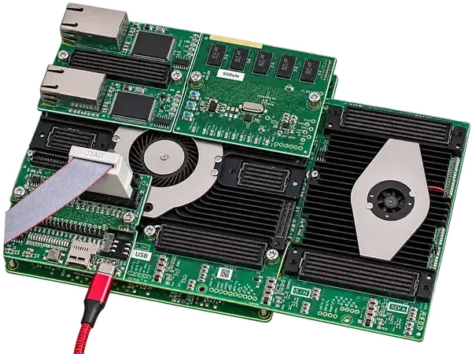

.. SPDX-FileCopyrightText: Copyright The Zephyr Project Contributors
.. SPDX-License-Identifier: Apache-2.0

.. zephyr:board:: riev_fpga_dev_board

Overview
********

.. note::

   All software for the Racyics edgeVision FPGA Development Board is experimental and hardware
   availability is restricted to the participants in the limited sampling program.

The Racyics edgeVision FPGA development board supports the edgeVision Cortex-M85 core.

   Racyics edgeVision FPGA development board

Hardware
********

The Racyics edgeVision FPGA Development Board is based on the
PRO DESIGN proFPGA duo prototyping platform.

The platform provides:

* Support for up to two interchangeable FPGA modules
* Up to 16 high-speed expansion sites
* Up to 2,200 I/O and inter-FPGA signals
* Eight configurable clock generators
* USB, Ethernet and PCIe host interfaces
* JTAG debugging and FPGA configuration

The edgeVision FPGA implementation provides:

* Arm Cortex-M85 processor running at 40 MHz
* 1 MB SRAM
* CMSDK UART operating at 921600 baud
* Cortex-M SysTick and NVIC interrupt controller

Currently, Zephyr supports the Cortex-M85 configuration.

Supported Features
==================

.. zephyr:board-supported-hw::

Programming and Debugging
*************************

Lauterbach TRACE32 can be used with a compatible debug probe to debug the Cortex-M85 through
JTAG. Install and configure the TRACE32 host tools as described in
:ref:`lauterbach-trace32-debug-host-tools`. Load the application ELF file, for example
``build/zephyr/zephyr.elf``, in TRACE32 to access its program and debug symbols.

Build the :zephyr:code-sample:`hello_world` sample for the board:

.. zephyr-app-commands::
   :zephyr-app: samples/hello_world
   :board: riev_fpga_dev_board/edgevision/m85
   :goals: build

References
**********

* `Racyics website <https://racyics.de/>`_
* `Sensry website <https://sensry.net/>`_
