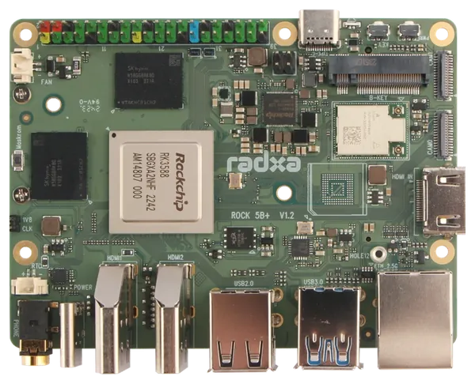

.. zephyr:board:: rock_5b_plus

Overview
********

The `Radxa ROCK 5B+`_ is a single-board computer based on the Rockchip RK3588
SoC. The SoC combines four Arm Cortex-A76 and four Arm Cortex-A55 CPU cores.
The board is available with up to 32 GB of LPDDR5 memory and provides eMMC,
microSD, PCIe, USB, Ethernet, and a 40-pin expansion header.

The SMP variant supports all four Cortex-A55 and four Cortex-A76 cores.

   Radxa ROCK 5B+ (Credit: Radxa)

Hardware
********

The ROCK 5B+ includes the following hardware features:

* Rockchip RK3588 SoC
* Four Arm Cortex-A76 cores up to 2.4 GHz and four Arm Cortex-A55 cores up to 1.8 GHz
* Arm Mali-G610 GPU and neural processing unit (NPU) with up to 6 TOPS
* 64-bit LPDDR5 memory, available in 4 GB, 8 GB, 12 GB, 16 GB, and 32 GB variants
* Onboard eMMC storage
* microSD card slot
* Two M.2 M Key connectors, each with a PCIe 3.0 x2 interface, for 2280 NVMe SSDs
  (M.2 SATA SSDs are not supported)
* M.2 B Key connector with SIM card slot for 4G modules
* 2.5 Gigabit Ethernet with Power over Ethernet (PoE) support (requires an optional PoE HAT)
* Onboard Realtek 8852BE Wi-Fi 6 and Bluetooth 5.2 module
* Two USB 2.0 host ports, two USB 3.1 Gen 1 ports (one host and one OTG), and one
  full-function USB Type-C port
* Two HDMI outputs, one DisplayPort output over USB Type-C, and one MIPI DSI output
* One standard HDMI input port supporting up to 4Kp60
* Two MIPI CSI camera interfaces
* 40-pin expansion header
* USB Type-C power delivery (PD 2.0)
* 100 mm x 75 mm board size

Supported Features
==================

.. zephyr:board-supported-hw::

The onboard Ethernet interface is not currently supported by Zephyr.

Serial Port
===========

Zephyr uses UART2 as the serial console at 1.5 Mbit/s.

Programming and Debugging
*************************

.. zephyr:board-supported-runners::

Applications are built with the standard configuration, for example:

.. zephyr-app-commands::
   :zephyr-app: samples/hello_world
   :host-os: unix
   :board: rock_5b_plus
   :goals: build

To run Zephyr on all eight CPU cores, build the SMP variant:

.. zephyr-app-commands::
   :zephyr-app: samples/synchronization
   :host-os: unix
   :board: rock_5b_plus//smp
   :goals: build

Create a legacy U-Boot image whose payload loads and runs at ``0x10000000``:

.. code-block:: console

   mkimage -C none -A arm64 -O linux -a 0x10000000 -e 0x10000000 \
     -d build/zephyr/zephyr.bin build/zephyr/zephyr.img

The Radxa U-Boot AArch64 Linux boot path requires a devicetree. Obtain
``rk3588-rock-5b-plus.dtb`` from the Radxa Linux distribution and copy it and
``zephyr.img`` to a FAT partition accessible from U-Boot.

Check the temporary kernel and devicetree load addresses provided by U-Boot:

.. code-block:: console

   printenv kernel_addr_r fdt_addr_r

Load each file at its corresponding address, then pass the devicetree address
to ``bootm``. Adjust the MMC device and partition numbers for the selected boot
media:

.. code-block:: console

   fatload mmc 1:1 ${kernel_addr_r} zephyr.img
   fatload mmc 1:1 ${fdt_addr_r} rk3588-rock-5b-plus.dtb
   bootm ${kernel_addr_r} - ${fdt_addr_r}

The legacy image header instructs U-Boot to move the Zephyr payload from
``kernel_addr_r`` to ``0x10000000`` before jumping to the entry point. Keeping
the temporary image, devicetree, and Zephyr runtime regions separate avoids
overwriting any of them during the handoff.

References
**********

More information is available from the `Radxa ROCK 5B+ documentation`_.

.. _Radxa ROCK 5B+:
   https://radxa.com/products/rock5/5bp

.. _Radxa ROCK 5B+ documentation:
   https://docs.radxa.com/en/rock5/rock5b
