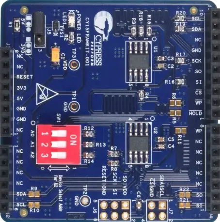

.. _cy15framkit_001:

CY15FRAMKIT-001 Serial F-RAM Development Kit
############################################

Overview
********

   CY15FRAMKIT-001 Serial F-RAM Development Kit (Credit: Infineon Technologies)

The Infineon CY15FRAMKIT-001 is an Arduino UNO R3 compatible shield carrying
two 256 Kbit serial F-RAM devices:

- FM24W256, on the Arduino I2C pins.
- FM25W256, on the Arduino SPI pins.

Both devices operate from 2.7 V to 5.5 V.  Jumper J5 selects whether the
shield runs from the host board's 3.3 V or 5 V rail, and the factory setting
is 5 V.  Set J5 to match the host board's I/O voltage before fitting the
shield.

Requirements
************

This shield can be used with any board that defines the ``arduino_header``,
``arduino_i2c`` and ``arduino_spi`` node labels.  See :ref:`shields` for more
details.

Pin Assignments
===============

+-------------+----------------------------+
| Shield Pin  | Function                   |
+=============+============================+
| D10         | FM25W256 chip select       |
+-------------+----------------------------+
| D11         | FM25W256 SI                |
+-------------+----------------------------+
| D12         | FM25W256 SO                |
+-------------+----------------------------+
| D13         | FM25W256 SCK               |
+-------------+----------------------------+
| SDA         | FM24W256 SDA               |
+-------------+----------------------------+
| SCL         | FM24W256 SCL               |
+-------------+----------------------------+

The shield pulls up SDA and SCL with 4.7 kOhm resistors to its supply rail.

I2C Address
===========

DIP switch SW1 sets the FM24W256 address pins A0 to A2.  A switch in the ON
position pulls its pin high.  The shield ships with all three off, which
gives address 0x50.

The devicetree in this shield describes address 0x51, with SW1 position 1
(A0) on and positions 2 and 3 off.  Set the switch to match, or change the
``reg`` property of the FM24W256 node.

Programming
***********

Set ``--shield cy15framkit_001`` when you invoke ``west build``.  For example:

.. zephyr-app-commands::
   :zephyr-app: samples/drivers/eeprom
   :board: kit_pse84_eval/pse846gps2dbzc4a/m33
   :shield: cy15framkit_001
   :goals: build

References
**********

- CY15FRAMKIT-001 Serial F-RAM Development Kit Guide, document 001-95689.
