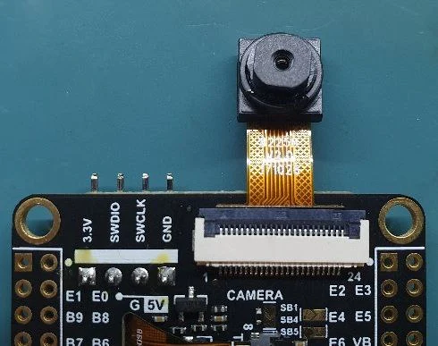

.. _dvp_24pin_ov2640:

DVP 24-pin OV2640 Camera Modules
################################

Overview
********

This shield supports the OV2640 camera modules with an 24-pin FFC connector compatible with the
de-facto standard for camera modules described here: :dtcompatible:`dvp-24pin-connector`

See :dtcompatible:`dvp-24pin-connector` for the pinout description.

Requirements
************

See :dtcompatible:`dvp-24pin-connector`

Programming
***********

Set ``--shield dvp_24pin_ov2640`` when you invoke ``west build``. For example:

.. zephyr-app-commands::
   :zephyr-app: samples/subsys/video/capture
   :board: mini_stm32h743
   :shield: dvp_24pin_ov2640
   :goals: build

References
**********

.. target-notes::

.. _Camera OV2640:
   https://blog.arducam.com/ov2640/

.. _OV2640 datasheet:
   https://www.uctronics.com/download/cam_module/OV2640DS.pdf
