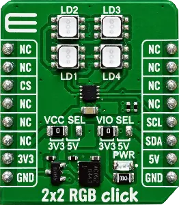

.. _mikroe_2x2_rgb_click_shield:

MikroElektronika 2x2 RGB Click
##############################

Overview
********

The 2x2 RGB Click carries four RGB LEDs arranged in a 2x2 matrix, driven by a
Kinetic KTD2052A 12-channel RGB LED driver. The driver is controlled over I2C
and sinks a programmable current per channel.

The shield exposes the KTD2052 through the :ref:`LED API <led_api>`: the four
RGB LEDs are LEDs 0 to 3, each with the three channels red, green and blue.

More information about the shield can be found at
`Mikroe 2x2 RGB click`_.

   MikroElektronika 2x2 RGB Click

Requirements
************

The shield uses a mikroBUS interface.
The target board must define the ``mikrobus_i2c`` node label
(see :ref:`shields` for more details).

Programming
***********

Set ``--shield mikroe_2x2_rgb_click`` when you invoke ``west build``. For example:

.. zephyr-app-commands::
   :zephyr-app: samples/hello_world
   :board: <board>
   :shield: mikroe_2x2_rgb_click
   :goals: build

References
**********

.. target-notes::

.. _Mikroe 2x2 RGB click:
   https://www.mikroe.com/2x2-rgb-click
