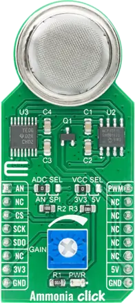

.. _mikroe_ammonia_click_shield:

MikroElektronika Ammonia Click
##############################

Overview
********

`Ammonia Click`_ is an ammonia (NH3) detection board based on the MQ-137 gas sensor. The sensor's
tin dioxide (SnO2) layer lowers its resistance when exposed to ammonia, in the range of 5 ppm to
500 ppm.

The sensor forms a voltage divider with a load resistor whose value is set with the GAIN trimmer.
The ADC SEL jumper routes the divider output either to the mikroBUS™ AN pin (default) or to an
on-board MCP3551 22-bit ADC read over SPI. The sensor heater is powered from 5 V and switched by a
MOSFET driven by the mikroBUS™ PWM pin.

   Ammonia Click

Hardware Configuration
**********************

The shield comes in two variants, matching the position of the ADC SEL SMD jumper:

- ``mikroe_ammonia_click``: ADC SEL in the AN position, as shipped. The sensor output is on the
  mikroBUS™ AN pin; sample it with the board's ADC channel for that pin, which some boards
  describe with the ``mikrobus_adc`` node label. This output comes from a divider powered from
  5 V and is not level shifted: on boards with 3.3 V ADC inputs, set the GAIN trimmer so that the
  voltage stays within the input range.

- ``mikroe_ammonia_click_spi``: ADC SEL in the SPI position. The MCP3551 samples the sensor output
  and is described on ``mikrobus_spi`` with the ``mcp3551_mikroe_ammonia_click`` node label. Its
  channel 0 is the ``io-channels`` entry of the ``zephyr,user`` node; a raw value converts to
  millivolts with :c:func:`adc_raw_to_millivolts_dt`.

Both variants describe the heater switch as a ``regulator-fixed`` node with the
``heater_mikroe_ammonia_click`` node label. The heater stays off at boot; enable it with
:c:func:`regulator_enable`. It draws about 170 mA from the 5 V rail, and a new sensor needs at
least 48 hours of preheating before it reaches its specified accuracy.

The output voltage depends on the GAIN trimmer setting, on the individual sensor, and on
temperature and humidity. The `MQ-137 datasheet`_ response curve, measured with a 4.7 kΩ load,
gives about 1 V at 10 ppm, 2 V at 100 ppm and 2.4 V at 500 ppm of NH3. Calibrate each sensor in
clean air and at a known concentration to convert readings to ppm.

Requirements
************

This shield can only be used with a board that provides a mikroBUS™ socket and defines the
``mikrobus_header`` node label for the mikroBUS™ GPIO connector, and for
``mikroe_ammonia_click_spi`` the ``mikrobus_spi`` node label for its SPI interface. See
:ref:`shields` for more details.

Programming
***********

Set ``--shield mikroe_ammonia_click`` or ``--shield mikroe_ammonia_click_spi`` when you invoke
``west build``. For example, to control the heater from the shell:

.. zephyr-app-commands::
   :zephyr-app: samples/regulator/regulator_shell
   :board: mikroe_clicker_ra4m1
   :shield: mikroe_ammonia_click
   :goals: build

Then run ``regulator enable mq137-heater`` in the shell to turn the heater on.

References
**********

- `Ammonia Click`_
- `Ammonia Click schematic`_
- `MQ-137 datasheet`_

.. _Ammonia Click: https://www.mikroe.com/ammonia-click

.. _Ammonia Click schematic:
   https://download.mikroe.com/documents/add-on-boards/click/ammonia/amonnia-click-schematic-v100.pdf

.. _MQ-137 datasheet: https://download.mikroe.com/documents/datasheets/MQ137_datasheet.pdf
