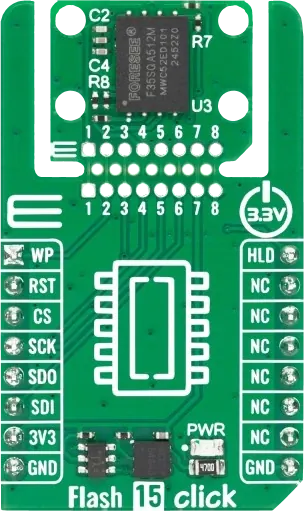

.. _mikroe_flash_15_click_shield:

MikroElektronika Flash 15 Click
###############################

Overview
********

`Flash 15 Click`_ is an add-on board with the F35SQA512M, a 512 Mbit SLC SPI NAND flash from
FORESEE. The memory has 2048-byte pages with a 64-byte spare area and 128 KiB blocks, and supports
standard, dual and quad SPI at up to 133 MHz. Its internal ECC logic is enabled by default and
corrects one bit error per 528 bytes. In addition to the main array, the flash has a
factory-programmed unique ID and 62 one-time programmable (OTP) pages.

   Flash 15 Click

Requirements
************

This shield can only be used with a board that provides a mikroBUS™ socket and defines a
``mikrobus_spi`` node label for the mikroBUS™ SPI interface. See :ref:`shields` for more
details.

The WP# pin of the flash is connected to the AN pin of the socket and the HOLD# pin to the PWM
pin. The ``mikrobus_header`` node of the board has to map both pins to GPIOs.

The RST pin of the socket selects the device that the CS pin reaches: the flash when it is high
and the ClickID memory of the board when it is low. The shield has a pull-up on this pin and
does not drive it.

Programming
***********

Set ``--shield mikroe_flash_15_click`` when you invoke ``west build``. For example:

.. zephyr-app-commands::
   :zephyr-app: samples/drivers/flash_shell
   :board: ek_ra8m1
   :shield: mikroe_flash_15_click
   :goals: build

References
**********

- `Flash 15 Click`_

.. _Flash 15 Click: https://www.mikroe.com/flash-15-click
