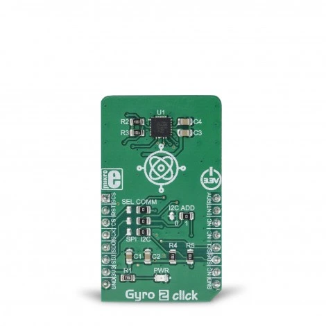

.. SPDX-FileCopyrightText: Copyright (c) 2026 Analog Devices, Inc.
.. SPDX-License-Identifier: Apache-2.0

.. _mikroe_gyro_2_click_shield:

MikroElektronika Gyro 2 Click
=============================

Overview
********

The `Gyro 2 Click`_ is a 3-axis digital gyroscope module powered by the NXP
`FXAS21002C`_. Set the SEL COMM jumpers to match the shield. mikroBUS CS
high selects SPI and low selects I2C. In SPI mode the chip select is
mikroBUS AN. In I2C mode AN stays high. The I2C address is ``0x21`` with
the default I2C ADD jumper.

Requirements
************

The header must map ``MIKROBUS_INT``, ``MIKROBUS_AN``, ``MIKROBUS_CS`` and
``MIKROBUS_RST``. The I2C shield needs ``mikrobus_i2c``. The SPI shield needs
``mikrobus_spi``. See :ref:`shields` for more details.

Programming
***********

Set ``-DSHIELD=mikroe_gyro_2_click_i2c`` when you invoke ``west build``.
For example:

.. zephyr-app-commands::
   :zephyr-app: samples/sensor/fxas21002
   :board: balletto_b1_dk/ab1c1f4m51820ph0
   :shield: mikroe_gyro_2_click_i2c
   :goals: build

See :dtcompatible:`nxp,fxas21002` for the FXAS21002 sensor binding.

References
**********

- `Gyro 2 Click`_
- `Gyro 2 Click schematic`_

.. _Gyro 2 Click:
   https://www.mikroe.com/gyro-2-click

.. _Gyro 2 Click schematic:
   https://download.mikroe.com/documents/add-on-boards/click/gyro_2_click/gyro-2-click-schematic-v100.pdf

.. _FXAS21002C:
   https://www.nxp.com/products/sensors/motion-sensors/gyroscopes/3-axis-digital-gyroscope:FXAS21002C
