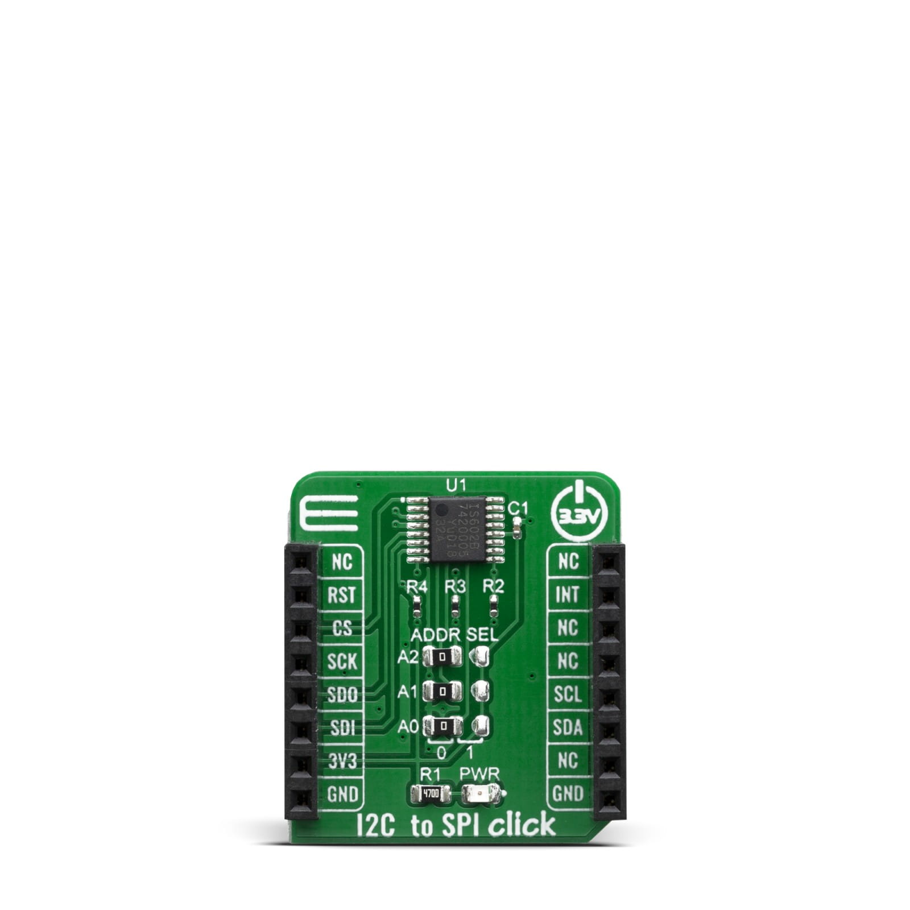

.. _mikroe_i2c_to_spi_click_shield:

MikroElektronika I2C to SPI Click
=================================

Overview
********

`I2C to SPI Click`_ is a mikroBUS™ add-on that converts the host I2C bus into
an SPI controller using the NXP SC18IS602B bridge.

The host talks I2C on the mikroBUS™ socket. SPI is provided on the Click extra
header (not the mikroBUS™ SPI pins).

   MikroElektronika I2C to SPI Click.

Requirements
************

This shield can only be used with a board that provides a mikroBUS™ socket and
defines ``mikrobus_i2c`` and ``mikrobus_header`` node labels. See
:ref:`shields` for more details.

The default I2C address is ``0x28``. Confirm the address jumpers on the Click.

RST is mikroBUS pin 2 (nexus index 1) and INT is mikroBUS pin 15 (nexus index 7).

Testing
*******

The bridge is exercised with the standard ``tests/drivers/spi/spi_loopback`` test
(hardware loopback, not ``SPI_MODE_LOOP`` — the SC18IS602B driver rejects the
latter).

**Wiring:** On the Click **extra SPI** header (not mikroBUS SPI), jumper
**MOSI to MISO** and use **SS0** as usual for loopback. The MCU mikroBUS SPI
pins are not used.

**Ensemble E8 DK** board files live under
``tests/drivers/spi/spi_loopback/boards/`` (overlay binds ``slow``/``fast`` on
``spi_click`` and disables unused ``mikrobus_spi``).

.. zephyr-app-commands::
   :zephyr-app: tests/drivers/spi/spi_loopback
   :board: ensemble_e8_dk/ae822fa0e5597ls0/rtss_hp
   :shield: mikroe_i2c_to_spi_click
   :goals: build

Twister: ``drivers.spi.loopback.mikroe_i2c_to_spi_click``.

To confirm the bridge on I2C, build a shell sample with I2C support and run
``i2c scan`` (expect ``0x28``).

References
**********

.. _I2C to SPI Click: https://www.mikroe.com/i2c-to-spi-click
