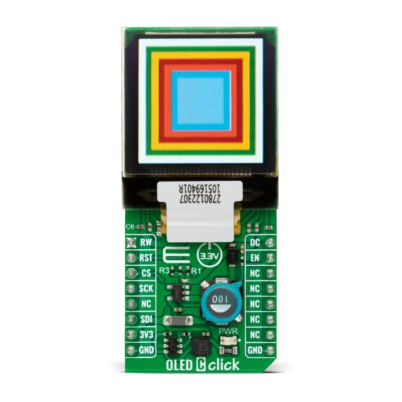

.. _mikroe_oled_c_click_shield:

MikroElektronika OLED C Click
#############################

Overview
********

The MikroElektronika `OLED C Click`_ carries a 96 x 96 pixel full-color OLED
panel (PSP27801) driven by an `SSD1351`_ controller, in a `mikroBUS™`_ form
factor. The controller is accessed over 4-wire SPI.

   MikroElektronika OLED C Click (Credit: MikroElektronika)

Pin assignments
===============

+-----------------------+-----------------------------------------+
| mikroBUS pin          | Function                                |
+=======================+=========================================+
| RST                   | Display reset                           |
+-----------------------+-----------------------------------------+
| CS                    | SPI chip select                         |
+-----------------------+-----------------------------------------+
| SCK                   | SPI clock                               |
+-----------------------+-----------------------------------------+
| MOSI                  | SPI data in (SDI)                       |
+-----------------------+-----------------------------------------+
| PWM                   | Data/command select (D/C)               |
+-----------------------+-----------------------------------------+
| INT                   | Enable (EN) for the OLED step-up supply |
+-----------------------+-----------------------------------------+

The MISO pin is not connected. The board runs at 3.3 V logic levels only.

Requirements
************

This shield can only be used with a development board that provides a
configuration for mikroBUS connectors and defines the ``mikrobus_spi`` and
``mikrobus_header`` devicetree nodelabels for the mikroBUS SPI interface and
GPIO header (see :ref:`shields` for more details).

Programming
***********

Set ``--shield mikroe_oled_c_click`` when you invoke ``west build``. For
example:

.. zephyr-app-commands::
   :zephyr-app: samples/drivers/display
   :board: ek_ra6m4
   :shield: mikroe_oled_c_click
   :goals: build

References
**********

- `OLED C Click`_
- `SSD1351`_
- `mikroBUS™`_

.. _SSD1351:
   https://www.solomon-systech.com/product/ssd1351/

.. _mikroBUS™:
   https://www.mikroe.com/mikrobus

.. _OLED C Click:
   https://www.mikroe.com/oled-c-click
