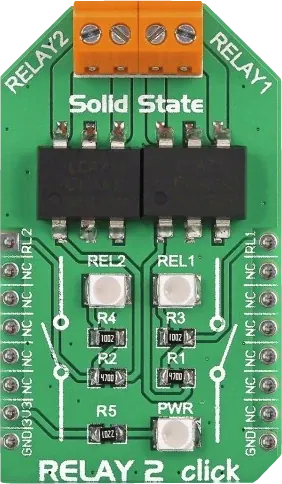

.. _mikroe_relay_2_click_shield:

MikroElektronika Relay 2 Click
##############################

Overview
********

`Relay 2 Click`_ carries two LCA717 single-pole, normally open solid state relays. Each relay
switches the two contacts of its own screw terminal and isolates the load from the host board with
3750 V\ :sub:`rms`.

The relays are wired in the AC/DC configuration of the `LCA717 datasheet`_, which gives each
output the following ratings:

- Blocking voltage: 30 V peak
- Continuous load current: 2 A (RMS or DC)
- On-resistance: 0.15 Ω maximum
- Turn-on and turn-off time: 3 ms maximum

   Relay 2 Click

Pin Assignment
==============

Each relay input is driven from a 3.3 V mikroBUS™ pin through a 380 Ω resistor and closes when the
pin is high. A red LED per relay shows the state of the pin.

+--------------+-----------+----------------+---------------------------------+
| mikroBUS pin | Relay     | Screw terminal | Devicetree node label           |
+==============+===========+================+=================================+
| PWM          | Relay1    | CN1            | ``mikroe_relay_2_click_relay1`` |
+--------------+-----------+----------------+---------------------------------+
| AN           | Relay2    | CN2            | ``mikroe_relay_2_click_relay2`` |
+--------------+-----------+----------------+---------------------------------+

Requirements
************

This shield can only be used with a board that provides a mikroBUS™ socket and defines a
``mikrobus_header`` node label that maps both the PWM and the AN pin to a GPIO. Boards that route
the AN pin to an analog-only input cannot drive Relay2. See :ref:`shields` for more details.

Programming
***********

Set ``--shield mikroe_relay_2_click`` when you invoke ``west build``. The relays are
:dtcompatible:`zephyr,gpio-relay` devices and are controlled with the :ref:`relay_api` API. For
example, to switch them from the shell:

.. zephyr-app-commands::
   :zephyr-app: samples/subsys/shell/shell_module
   :board: ek_ra8m1
   :shield: mikroe_relay_2_click
   :gen-args: -DCONFIG_RELAY=y -DCONFIG_RELAY_SHELL=y
   :goals: build

.. code-block:: console

   uart:~$ relay list
   relay-2
   relay-1
   uart:~$ relay on relay-1
   uart:~$ relay off relay-1

References
**********

- `Relay 2 Click`_
- `LCA717 datasheet`_

.. _Relay 2 Click: https://www.mikroe.com/relay-2-click
.. _LCA717 datasheet:
   https://www.littelfuse.com/assetdocs/littelfuse-integrated-circuits-lca717-datasheet?assetguid=178c1173-4b67-4132-91ab-197f34356fb1
