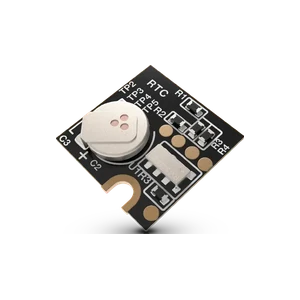

.. _rakwireless_rak12002:

RAK12002 WisBlock RTC Module
############################

Overview
********

RAK12002 is a WisBlock module carrying a Micro Crystal RV-3028-C7 real-time clock. It mounts
on a WisBlock Sensor Slot and communicates over I2C at address 0x52. A supercapacitor on the
VBACKUP pin keeps the clock running while the base board is unpowered.

   RAK12002 WisBlock RTC Module (Credit: RAKwireless)

More information about the module can be found at `RAK12002 WisBlock RTC Module`_.

Requirements
************

RAK12002 requires a WisBlock Base Board and a WisBlock Core module. The base board supplies
the Sensor Slot nodes this shield attaches to, so its shield must be listed first.

One shield is provided per Sensor Slot. Which slots exist depends on the base board.
RAKwireless documents mounting the module on slots A to D; the module drives only signals
that every slot variant carries, so a shield is provided for each of the six.

.. list-table::
   :header-rows: 1

   * - Shield
     - Sensor Slot
   * - ``rakwireless_rak12002_sensor_a``
     - A
   * - ``rakwireless_rak12002_sensor_b``
     - B
   * - ``rakwireless_rak12002_sensor_c``
     - C
   * - ``rakwireless_rak12002_sensor_d``
     - D
   * - ``rakwireless_rak12002_sensor_e``
     - E
   * - ``rakwireless_rak12002_sensor_f``
     - F

Pin Assignments
***************

The RV-3028-C7 interrupt output reaches the base board through Sensor Slot GPIO1, which
resolves to a different WisBlock IO line on each slot. CLKOUT reaches GPIO2 and is left
disabled, as the application manual recommends when the clock output is unused.

+--------+-------------+-------+-----+-----+-----+-----+-----+
| Signal | Sensor Slot | A     | B   | C   | D   | E   | F   |
|        | pin         |       |     |     |     |     |     |
+========+=============+=======+=====+=====+=====+=====+=====+
| INT    | 10 (GPIO1)  | (IO2) | IO1 | IO4 | IO6 | IO3 | IO5 |
+--------+-------------+-------+-----+-----+-----+-----+-----+
| CLKOUT | 12 (GPIO2)  | IO1   | IO2 | IO3 | IO5 | IO4 | IO6 |
+--------+-------------+-------+-----+-----+-----+-----+-----+

A parenthesized line is wired but is not put in ``int-gpios``. WisBlock IO2 drives the
switched 3V3_S rail, so the Sensor Slot A shield does not claim it and that slot is read by
polling. The module itself is powered from the always-on 3V3 rail, so it keeps time on every
slot.

Backup Supply
*************

The shield selects Direct Switching Mode and enables the trickle charger with the 3 kOhm
series resistance, which is what the RV-3028-C7 application manual gives for a supercapacitor
backup source. The settings are written to the EEPROM of the RTC, so they survive a power
cycle.

Programming
***********

List the base board shield before this one so the Sensor Slot nodes exist:

.. zephyr-app-commands::
   :zephyr-app: tests/drivers/rtc/rtc_api
   :board: rak4631/nrf52840
   :shield: rakwireless_rak19007,rakwireless_rak12002_sensor_c
   :goals: build flash

References
**********

.. target-notes::

.. _RAK12002 WisBlock RTC Module:
   https://docs.rakwireless.com/product-categories/wisblock/rak12002
