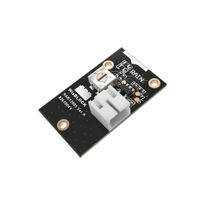

.. _rakwireless_rak12005:

RAK12005 WisBlock Rain Sensor
#############################

Overview
********

RAK12005 is a WisBlock module that detects water and other electroconductive
liquids. The detection area is a separate board, the RAK12030, which reaches
the module over a cable so that it can sit in the open while the rest of the
WisBlock solution stays dry.

   RAK12005 WisBlock Rain Sensor (Credit: RAKwireless)

A Microchip MCP606 compares the voltage across the detection area against half
the supply. A dry area is close to an open circuit and holds the comparator
output low; a wet one pulls it down and the output goes high. The module
reports that one line and nothing else, so it appears as a button rather than
as a sensor.

More information about the module can be found at `RAK12005 WisBlock Rain Sensor`_.

Requirements
************

RAK12005 requires a WisBlock Base Board and a WisBlock Core module. The base
board supplies the IO slot nodes this shield attaches to, so its shield must be
listed first.

Pin Assignments
***************

+--------+-------------------------------------------------------------+
| Signal | Use                                                         |
+========+=============================================================+
| IO6    | Comparator output, high while the detection area is wet     |
+--------+-------------------------------------------------------------+

The module runs from the always-on 3V3 rail, so nothing has to be switched on
before it reports.

Detection Threshold
*******************

How wet the area has to be before the output flips is set by a potentiometer
on the module rather than in software, so nothing in devicetree describes it.

Programming
***********

List the base board shield before this one so the IO slot nodes exist:

.. zephyr-app-commands::
   :zephyr-app: samples/basic/button
   :board: rak4631/nrf52840
   :shield: rakwireless_rak19007,rakwireless_rak12005
   :goals: build flash

References
**********

.. target-notes::

.. _RAK12005 WisBlock Rain Sensor:
   https://docs.rakwireless.com/product-categories/wisblock/rak12005
