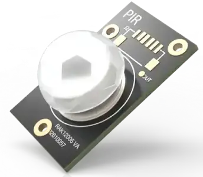

.. _rakwireless_rak12006:

RAK12006 WisBlock PIR Sensor
############################

Overview
********

RAK12006 is a WisBlock IO-slot module built around the Senba AM312 PIR
sensor. It reports occupancy on WisBlock IO6, which is low while motion is
detected. The module draws power from the base board 3V3 rail. An optional
3V3_S supply can be selected with the module resistors. WisBlock IO2 switches
that rail and is not controlled by this shield.

IO6 is also wired to sensor slot D, so this shield cannot be combined with a
slot D module that uses that pin.

   RAK12006 WisBlock PIR Sensor (Credit: RAKwireless)

More information about the module can be found at
`RAK12006 WisBlock PIR Sensor`_.

Requirements
************

This shield requires a WisBlock core that provides the ``wisblock_io``
connector, for example ``rak4631/nrf52840``. The core is mounted on a WisBlock
base board such as the RAK19007, which exposes the IO slot.

Programming
***********

Set both shields when you invoke ``west build``. For example when running the
:zephyr:code-sample:`button` sample:

.. zephyr-app-commands::
   :zephyr-app: samples/basic/button
   :board: rak4631/nrf52840
   :shield: rakwireless_rak19007,rakwireless_rak12006
   :goals: build

Motion on IO6 is delivered as input event ``INPUT_KEY_0``. The sample prints
that event and, when the base board provides ``led0``, turns the user LED on
while motion is reported.

.. _RAK12006 WisBlock PIR Sensor:
   https://docs.rakwireless.com/product-categories/wisblock/rak12006
