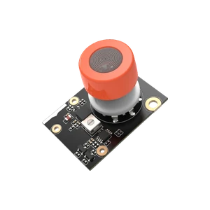

.. _rakwireless_rak12009:

RAK12009 WisBlock Alcohol Gas Sensor
####################################

Overview
********

RAK12009 is a WisBlock module carrying a Winsen MQ-3B sensor, which detects
alcohol over a range of 25 to 500 ppm. It mounts on the WisBlock IO slot.

The sensing element is a heated resistor whose value falls as the gas grows
denser. A boost converter raises the battery rail to the 5 V the heater needs,
the element divides that rail with a trimmed load resistor, and a Texas
Instruments ADC121C021 at I2C address ``0x55`` reads the divided voltage.

   RAK12009 WisBlock Alcohol Gas Sensor (Credit: RAKwireless)

More information about the module can be found at `RAK12009 WisBlock Alcohol Gas Sensor`_.

Requirements
************

RAK12009 requires a WisBlock Base Board and a WisBlock Core module. The base
board supplies the IO slot nodes this shield attaches to, so its shield must be
listed first.

Pin Assignments
***************

+-----------------+-------------------------------------------------------+
| Signal          | Use                                                   |
+=================+=======================================================+
| I2C1 SDA, SCL   | ADC121C021, level shifted between 3V3 and 5 V         |
+-----------------+-------------------------------------------------------+
| IO6             | Enables the boost converter that feeds the heater     |
+-----------------+-------------------------------------------------------+
| IO5             | ADC alert output, pulled up to 5 V and left unclaimed |
+-----------------+-------------------------------------------------------+

The alert output is pulled to 5 V, which is outside what the WisBlock Core
modules accept on an IO pin, so this shield does not put it in devicetree.

Measuring a Concentration
*************************

The driver reports the sensor resistance on ``SENSOR_CHAN_GAS_RES`` from the
load resistance this shield states. Turning that into parts per million needs
the resistance the part shows in clean air and the sensitivity curve of the gas
being watched, neither of which the module can tell. Set the first with
``SENSOR_ATTR_MQ_R0`` after leaving the sensor in clean air.

The shield states the second, read off Fig. 3 of the MQ-3B datasheet for
ethanol, the gas the sensitivity of the part is specified against. Watching
one of the other gases the part responds to means overriding
``curve-scale-milli`` and ``curve-exponent-milli`` with the curve of that
gas.

The load resistor is a potentiometer, so a board trimmed away from the 10 kOhm
this shield assumes needs ``load-resistance-ohms`` set to the value it was
trimmed to.

Programming
***********

List the base board shield before this one so the IO slot nodes exist:

.. zephyr-app-commands::
   :zephyr-app: samples/sensor/sensor_shell
   :board: rak4631/nrf52840
   :shield: rakwireless_rak19007,rakwireless_rak12009
   :goals: build flash

References
**********

.. target-notes::

.. _RAK12009 WisBlock Alcohol Gas Sensor:
   https://docs.rakwireless.com/product-categories/wisblock/rak12009
