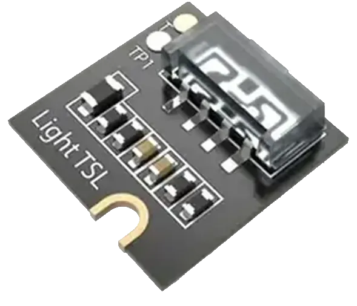

.. _rakwireless_rak12010:

RAK12010 WisBlock Ambient Light Sensor Module
##############################################

Overview
********

RAK12010 is a WisBlock module carrying a Vishay VEML7700 ambient light sensor.
The sensor connects to the WisBlock I2C1 bus at address 0x10 and brings out no
other signal, so it works in any of the Sensor Slots A to F without a slot
specific configuration. The driver reports illuminance in lux.

   RAK12010 WisBlock Ambient Light Sensor Module (Credit: RAKwireless)

More information about the module can be found at `RAK12010 WisBlock Ambient Light Sensor Module`_.

Requirements
************

RAK12010 requires a WisBlock Base Board and a WisBlock Core module. The base
board shield must be listed first, because that is where ``wisblock_3v3_s`` is
defined.

The module runs from the switched 3V3_S rail, which WisBlock IO2 enables. When
the sensor subsystem is enabled, this shield turns that rail on before the
VEML7700 driver probes the device.

Programming
***********

.. zephyr-app-commands::
   :zephyr-app: samples/sensor/light_polling
   :board: rak4631/nrf52840
   :shield: rakwireless_rak19007,rakwireless_rak12010
   :goals: build flash

The sample prints one illuminance reading per second. Covering the sensor
lowers the reported lux.

References
**********

.. target-notes::

.. _RAK12010 WisBlock Ambient Light Sensor Module:
   https://docs.rakwireless.com/product-categories/wisblock/rak12010
