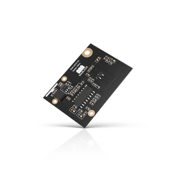

.. _rakwireless_rak12013:

RAK12013 WisBlock Radar Sensor
##############################

Overview
********

RAK12013 is a WisBlock IO-slot module built around the RCWL-9196 3.2 GHz
Doppler radar. It reports motion on WisBlock IO3, which is high while motion
is detected. WisBlock IO4 is the active-high enable input and is turned on at
boot. The module draws power from the base board ``3V3_S`` rail. WisBlock
IO2 switches that rail and is not controlled by this shield.

IO3 and IO4 are also wired to sensor slot C, so this shield cannot be combined
with a slot C module that uses those pins.

   RAK12013 WisBlock Radar Sensor (Credit: RAKwireless)

More information about the module can be found at
`RAK12013 WisBlock Radar Sensor`_.

Requirements
************

This shield requires a WisBlock core that provides the ``wisblock_io``
connector, for example ``rak4631/nrf52840``. The core is mounted on a WisBlock
base board such as the RAK19007, which exposes the IO slot.

Programming
***********

Set both shields when you invoke ``west build``. For example when running the
:zephyr:code-sample:`button` sample:

.. zephyr-app-commands::
   :zephyr-app: samples/basic/button
   :board: rak4631/nrf52840
   :shield: rakwireless_rak19007,rakwireless_rak12013
   :goals: build

Motion on IO3 is delivered as input event ``INPUT_KEY_0``. The sample prints
that event and, when the base board provides ``led0``, turns the user LED on
while motion is reported.

.. _RAK12013 WisBlock Radar Sensor:
   https://docs.rakwireless.com/product-categories/wisblock/rak12013
