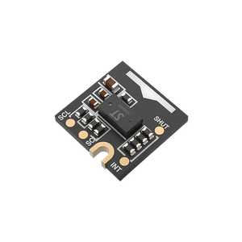

.. _rakwireless_rak12014:

RAK12014 WisBlock ToF Sensor Module
###################################

Overview
********

RAK12014 is a WisBlock module carrying an STMicroelectronics VL53L0X time-of-flight
ranging sensor, which measures distance up to 2 m with a 940 nm laser. It mounts on a
WisBlock Sensor Slot and communicates over I2C at address 0x29. The shutdown input and
the interrupt output both reach the Sensor Slot connector, and the module runs from the
switched 3V3_S rail.

   RAK12014 WisBlock ToF Sensor Module (Credit: RAKwireless)

More information about the module can be found at `RAK12014 WisBlock ToF Sensor Module`_.

Requirements
************

RAK12014 requires a WisBlock Base Board and a WisBlock Core module. The base board
supplies the Sensor Slot nodes this shield attaches to, so its shield must be listed
first.

One shield is provided per Sensor Slot. Which slots exist depends on the base board.

.. list-table::
   :header-rows: 1

   * - Shield
     - Sensor Slot
   * - ``rakwireless_rak12014_sensor_c``
     - C
   * - ``rakwireless_rak12014_sensor_d``
     - D
   * - ``rakwireless_rak12014_sensor_e``
     - E
   * - ``rakwireless_rak12014_sensor_f``
     - F

Sensor Slots A and B are not offered, which is the list the datasheet gives. Both carry
WisBlock IO2 as one of their two slot GPIO pins, and IO2 drives the switched 3V3_S rail
the module runs from. In Slot A it lands on XSHUT, which the module pulls up, so the
sensor would still range and still raise its interrupt but could not be shut down
without taking the rail with it. In Slot B it lands on the interrupt output, which would
pull the rail enable low every time the sensor raised it.

Pin Assignments
***************

Both signals reach the base board through the Sensor Slot GPIO pins, which resolve to a
different WisBlock IO line on each slot.

+--------+-------------+-----+-----+-----+-----+
| Signal | Sensor Slot | C   | D   | E   | F   |
|        | pin         |     |     |     |     |
+========+=============+=====+=====+=====+=====+
| XSHUT  | 10 (GPIO1)  | IO4 | IO6 | IO3 | IO5 |
+--------+-------------+-----+-----+-----+-----+
| INT    | 12 (GPIO2)  | IO3 | IO5 | IO4 | IO6 |
+--------+-------------+-----+-----+-----+-----+

The module fits 10 kohm pull-ups on both lines, so XSHUT idles released and the sensor
runs as soon as the rail is up. The I2C pull-ups are left to the base board.

The driver waits on the interrupt for a ready measurement. Removing ``int-gpios``
from the node makes it poll over I2C instead.

Programming
***********

List the base board shield before this one so the Sensor Slot nodes exist:

.. zephyr-app-commands::
   :zephyr-app: samples/sensor/distance_polling
   :board: rak4631/nrf52840
   :shield: rakwireless_rak19007,rakwireless_rak12014_sensor_c
   :goals: build flash

References
**********

.. target-notes::

.. _RAK12014 WisBlock ToF Sensor Module:
   https://docs.rakwireless.com/product-categories/wisblock/rak12014
