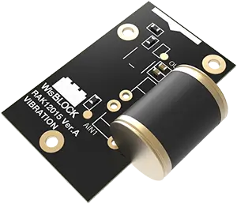

.. _rakwireless_rak12015:

RAK12015 WisBlock Vibration Sensor
##################################

Overview
********

RAK12015 is a WisBlock IO-slot module built around the ANT-801S vibration
sensor. Connector pin 22 (AIN1) is low while the sensor is still and produces
a square wave while it is vibrating. The module draws power from the base
board ``3V3_S`` rail. WisBlock IO2 switches that rail and is not controlled by
this shield. The optional IO4 conditioning circuit is not fitted and is not
used.

   RAK12015 WisBlock Vibration Sensor (Credit: RAKwireless)

More information about the module can be found at
`RAK12015 WisBlock Vibration Sensor`_.

Requirements
************

This shield requires a WisBlock core that provides the ``wisblock_io``
connector, for example ``rak4631/nrf52840``. The core is mounted on a WisBlock
base board such as the RAK19007, which exposes the IO slot.

Programming
***********

Set both shields when you invoke ``west build``. For example when running the
:zephyr:code-sample:`button` sample:

.. zephyr-app-commands::
   :zephyr-app: samples/basic/button
   :board: rak4631/nrf52840
   :shield: rakwireless_rak19007,rakwireless_rak12015
   :goals: build

Vibration on AIN1 is delivered as input event ``INPUT_KEY_0``. The sample
prints that event and, when the base board provides ``led0``, turns the user
LED on while a pulse is high.

.. _RAK12015 WisBlock Vibration Sensor:
   https://docs.rakwireless.com/product-categories/wisblock/rak12015
