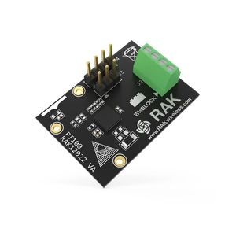

.. _rakwireless_rak12022:

RAK12022 WisBlock PT100 Module
##############################

Overview
********

RAK12022 is a WisBlock IO module carrying an Analog Devices MAX31865 RTD-to-digital
converter and a four-pole terminal block for a PT100 probe. The converter reaches the
WisBlock Core over the IO slot SPI bus and runs from the switched 3V3_S rail.

   RAK12022 WisBlock PT100 Module (Credit: RAKwireless)

More information about the module can be found at `RAK12022 WisBlock PT100 Module`_.

Requirements
************

RAK12022 requires a WisBlock Base Board and a WisBlock Core module. It mounts on the
WisBlock IO slot, so the base board shield must be listed first.

Pin Assignments
***************

+--------+-------------------+
| Signal | WisBlock IO pin   |
+========+===================+
| CS     | 25 (SPI_CS)       |
+--------+-------------------+
| SCLK   | 26 (SPI_CLK)      |
+--------+-------------------+
| MISO   | 27 (SPI_MISO)     |
+--------+-------------------+
| MOSI   | 28 (SPI_MOSI)     |
+--------+-------------------+
| DRDY   | 38 (IO6)          |
+--------+-------------------+

The module also routes CS to IO3 and IO4 through resistors that are left unpopulated,
so those paths are not described here.

RTD Wiring
**********

The terminal block J2 accepts a 2-wire, 3-wire or 4-wire PT100, and jumpers J3 and J4
select the mode. Each mode has its own shield, named after the probe it is wired for:

+--------+-----------+-----------------+--------------------------------+
| Probe  | J3        | J4              | Shield                         |
+========+===========+=================+================================+
| 2-wire | 2-3       | 1-2 and 3-4     | ``rakwireless_rak12022_2wire`` |
+--------+-----------+-----------------+--------------------------------+
| 3-wire | 1-2       | 3-4             | ``rakwireless_rak12022_3wire`` |
+--------+-----------+-----------------+--------------------------------+
| 4-wire | 2-3       | open            | ``rakwireless_rak12022_4wire`` |
+--------+-----------+-----------------+--------------------------------+

The MAX31865 compensates a 3-wire probe for the resistance of its leads and treats a
2-wire and a 4-wire probe alike. A shield that does not match the jumpers still builds
and still reads the converter, so the error shows up only as a temperature offset: for
a PT100, 0.4 ohms of lead resistance moves the reading by about 1 degree Celsius.

The reference resistor fitted on the module is 400 ohms, the value the MAX31865
datasheet gives for a PT100.

Mains Filter
************

The converter rejects 60 Hz by default. Where the mains runs at 50 Hz:

.. code-block:: devicetree

   &max31865_rak12022 {
       filter-50hz;
   };

Programming
***********

List the base board shield before this one:

.. zephyr-app-commands::
   :zephyr-app: samples/sensor/thermometer
   :board: rak4631/nrf52840
   :shield: rakwireless_rak19007,rakwireless_rak12022_3wire
   :goals: build flash

References
**********

.. target-notes::

.. _RAK12022 WisBlock PT100 Module:
   https://docs.rakwireless.com/product-categories/wisblock/rak12022
