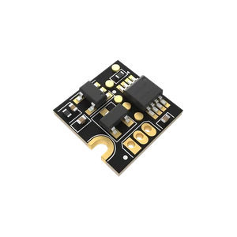

.. _rakwireless_rak12044:

RAK12044 WisBlock Hall Effect Sensor Module
###########################################

Overview
********

RAK12044 is a WisBlock module carrying a Texas Instruments DRV5056 Hall-effect sensor.
The sensor answers a magnetic field with an analog voltage, which a buffer feeds to a
Texas Instruments ADC121C021 on the WisBlock I2C1 bus at address 0x56. The module fits
the A4 version of the sensor, 15 mV/mT over a 155 mT range at 3.3 V.

   RAK12044 WisBlock Hall Effect Sensor Module (Credit: RAKwireless)

More information about the module can be found at `RAK12044 WisBlock Hall Effect Sensor
Module`_.

Requirements
************

RAK12044 requires a WisBlock Base Board and a WisBlock Core module. The base board
supplies the Sensor Slot this shield mounts on, so its shield must be listed first.

The module runs from the switched 3V3_S rail, which WisBlock IO2 enables, so the shield
names that rail as the converter's power domain.

The ADC routes its alert output to the slot GPIO1 pin, but the Zephyr ADCxx1C driver
reads the conversion over I2C and defines no property for that pin, so it is left
unused. Sensor Slot B is not offered, which is the list the datasheet gives: it carries
WisBlock IO2 as a slot GPIO pin, and that is the line switching the rail the module runs
from.

Reading the Field
*****************

The sensor is unipolar. It answers a south pole only, and a field of the other polarity
leaves the output at its quiescent voltage.

That quiescent voltage is 0.6 V nominal but ranges from 0.55 V to 0.65 V, which is
+-3.3 mT of offset on a part that is not calibrated. An application that needs the
field around zero to read as zero records what the sensor reports with no magnet near
it and subtracts that.

Programming
***********

List the base board shield before this one so the I2C node exists:

.. zephyr-app-commands::
   :zephyr-app: samples/sensor/sensor_shell
   :board: rak4631/nrf52840
   :shield: rakwireless_rak19007,rakwireless_rak12044
   :goals: build flash

References
**********

.. target-notes::

.. _RAK12044 WisBlock Hall Effect Sensor Module:
   https://docs.rakwireless.com/product-categories/wisblock/rak12044
