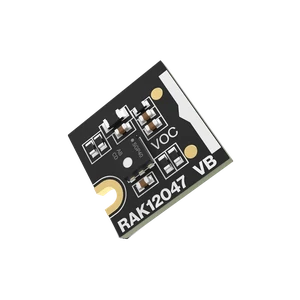

.. _rakwireless_rak12047:

RAK12047 WisBlock VOC Sensor Module
###################################

Overview
********

RAK12047 is a WisBlock module carrying a Sensirion SGP40 metal-oxide gas sensor, which
reports a volatile organic compound index. The module connects to the WisBlock I2C1 bus
at address 0x59 and brings out no other signal, so it works in any of the Sensor Slots A
to F without a slot specific configuration.

   RAK12047 WisBlock VOC Sensor Module (Credit: RAKwireless)

More information about the module can be found at `RAK12047 WisBlock VOC Sensor Module`_.

Requirements
************

RAK12047 requires a WisBlock Base Board and a WisBlock Core module. The base board
supplies the Sensor Slot this shield mounts on, so its shield must be listed first.

The module runs from the switched 3V3_S rail, which WisBlock IO2 enables, so the shield
names that rail as the sensor's power domain.

Humidity Compensation
*********************

The SGP40 compensates its raw signal for ambient humidity and temperature, and without
them it assumes 50 %RH and 25 degrees Celsius. An application that has those readings
from another module passes them on before each measurement:

.. code-block:: c

   sensor_attr_set(sgp40, SENSOR_CHAN_GAS_RES,
                   SENSOR_ATTR_SGP40_TEMPERATURE, &temperature);
   sensor_attr_set(sgp40, SENSOR_CHAN_GAS_RES,
                   SENSOR_ATTR_SGP40_HUMIDITY, &humidity);

The driver can also run the sensor's own self test at init, which takes about 250 ms:

.. code-block:: devicetree

   &sgp40_rak12047 {
       enable-selftest;
   };

Programming
***********

List the base board shield before this one so the I2C node exists:

.. zephyr-app-commands::
   :zephyr-app: samples/sensor/sensor_shell
   :board: rak4631/nrf52840
   :shield: rakwireless_rak19007,rakwireless_rak12047
   :goals: build flash

References
**********

.. target-notes::

.. _RAK12047 WisBlock VOC Sensor Module:
   https://docs.rakwireless.com/product-categories/wisblock/rak12047
