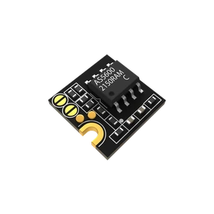

.. _rakwireless_rak12054:

RAK12054 WisBlock Encoder Sensor Module
#######################################

Overview
********

RAK12054 is a WisBlock module carrying an ams OSRAM AS5600 magnetic rotary position
sensor, which reports the angle of a diametrically magnetised magnet turning above it.
The module connects to the WisBlock I2C1 bus at address 0x36.

   RAK12054 WisBlock Encoder Sensor Module (Credit: RAKwireless)

More information about the module can be found at `RAK12054 WisBlock Encoder Sensor
Module`_.

Requirements
************

RAK12054 requires a WisBlock Base Board and a WisBlock Core module. The base board
supplies the Sensor Slot this shield mounts on, so its shield must be listed first.

The module runs from the switched 3V3_S rail, which WisBlock IO2 enables, so the shield
names that rail as the sensor's power domain.

The sensor also drives its angle out of an OUT pin, which reaches the Sensor Slot GPIO1
pin, but that output carries the same angle the driver reads over I2C, so the shield
leaves the pin alone. Which way the angle counts is set by solder bridges on the module
rather than by anything the core can reach. Sensor Slot B is not offered, which is the
list the datasheet gives.

Programming
***********

List the base board shield before this one so the I2C node exists:

.. zephyr-app-commands::
   :zephyr-app: samples/sensor/sensor_shell
   :board: rak4631/nrf52840
   :shield: rakwireless_rak19007,rakwireless_rak12054
   :goals: build flash

References
**********

.. target-notes::

.. _RAK12054 WisBlock Encoder Sensor Module:
   https://docs.rakwireless.com/product-categories/wisblock/rak12054
