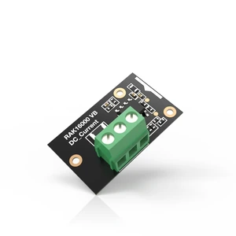

.. _rakwireless_rak16000:

RAK16000 WisBlock DC Current Module
###################################

Overview
********

RAK16000 is a WisBlock module built around the Texas Instruments INA219BID
current and power monitor. It mounts on the WisBlock IO slot and connects to
the WisBlock I2C1 bus at address ``0x41``. The module shunt is 100 milliohm,
which covers about 0 to 3 A. The measured bus voltage range is 0 to 26 V.

Only I2C1, the 3V3_S supply, and ground are wired on the module connector.
The current inputs are the IN+ and IN- terminals on the board.

   RAK16000 WisBlock DC Current Module (Credit: RAKwireless)

More information about the module can be found at
`RAK16000 WisBlock DC Current Module`_.

Requirements
************

This shield requires a WisBlock core that provides the ``wisblock_i2c1``
node label, for example ``rak4631/nrf52840``. The core is mounted on a
WisBlock base board such as the RAK19007. RAK16000 uses the base IO slot.

The module is powered from the base 3V3_S rail. WisBlock IO2 switches
that rail. This shield does not drive IO2.

Programming
***********

Set ``--shield rakwireless_rak16000`` when you invoke ``west build``.
For example:

.. zephyr-app-commands::
   :zephyr-app: samples/sensor/ina219
   :board: rak4631/nrf52840
   :shield: rakwireless_rak16000
   :goals: build

See :dtcompatible:`ti,ina219` to change the shunt or the current LSB after
the address-select resistors on the module are changed.

.. _RAK16000 WisBlock DC Current Module:
   https://docs.rakwireless.com/product-categories/wisblock/rak16000
