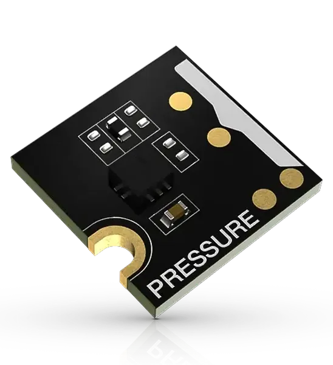

.. _rakwireless_rak1902:

RAK1902 WisBlock Barometer Pressure Sensor Module
#################################################

Overview
********

RAK1902 is a WisBlock module carrying an STMicroelectronics LPS22HB barometric pressure
sensor, which also reports temperature. The module connects to the WisBlock I2C1 bus at
address 0x5C and brings out no other signal, so it works in any of the Sensor Slots A to
F without a slot specific configuration.

   RAK1902 WisBlock Barometer Pressure Sensor Module (Credit: RAKwireless)

More information about the module can be found at `RAK1902 WisBlock Barometer Pressure
Sensor Module`_.

Requirements
************

RAK1902 requires a WisBlock Base Board and a WisBlock Core module. The base board supplies
the Sensor Slot this shield mounts on, so its shield must be listed first.

The LPS22HB routes its data-ready output to the slot IO1 pin, but the Zephyr driver polls
the sensor and defines no interrupt property, so that pin is left unused.

Programming
***********

List the base board shield before this one so the I2C node exists:

.. zephyr-app-commands::
   :zephyr-app: samples/sensor/lps22hb
   :board: rak4631/nrf52840
   :shield: rakwireless_rak19007,rakwireless_rak1902
   :goals: build flash

References
**********

.. target-notes::

.. _RAK1902 WisBlock Barometer Pressure Sensor Module:
   https://docs.rakwireless.com/product-categories/wisblock/rak1902
