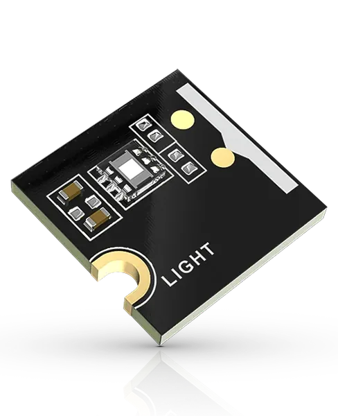

.. _rakwireless_rak1903:

RAK1903 WisBlock Ambient Light Sensor Module
############################################

Overview
********

RAK1903 is a WisBlock module carrying a Texas Instruments OPT3001 ambient light sensor.
It mounts on a WisBlock Sensor Slot and communicates over I2C at address 0x44. The
OPT3001 interrupt output reaches the Sensor Slot connector.

   RAK1903 WisBlock Ambient Light Sensor Module (Credit: RAKwireless)

More information about the module can be found at `RAK1903 WisBlock Ambient Light Sensor
Module`_.

Requirements
************

RAK1903 requires a WisBlock Base Board and a WisBlock Core module. The base board supplies
the Sensor Slot nodes this shield attaches to, so its shield must be listed first.

One shield is provided per Sensor Slot. Which slots exist depends on the base board.

.. list-table::
   :header-rows: 1

   * - Shield
     - Sensor Slot
   * - ``rakwireless_rak1903_sensor_a``
     - A
   * - ``rakwireless_rak1903_sensor_c``
     - C
   * - ``rakwireless_rak1903_sensor_d``
     - D
   * - ``rakwireless_rak1903_sensor_e``
     - E
   * - ``rakwireless_rak1903_sensor_f``
     - F

Pin Assignments
***************

The OPT3001 interrupt output reaches the base board through the Sensor Slot GPIO2 pin,
which resolves to a different WisBlock IO line on each slot.

+--------+-------------+-----+-----+-----+-----+-----+
| Signal | Sensor Slot | A   | C   | D   | E   | F   |
|        | pin         |     |     |     |     |     |
+========+=============+=====+=====+=====+=====+=====+
| INT    | 12 (GPIO2)  | IO1 | IO3 | IO5 | IO4 | IO6 |
+--------+-------------+-----+-----+-----+-----+-----+

Sensor Slot B is not offered because the datasheet does not list it among the slots the
module can be mounted on.

The OPT3001 driver polls unless the application asks for the interrupt, which needs
:kconfig:option:`CONFIG_GPIO` and a trigger thread::

   CONFIG_GPIO=y
   CONFIG_OPT300X_TRIGGER_GLOBAL_THREAD=y

Programming
***********

List the base board shield before this one so the Sensor Slot nodes exist:

.. zephyr-app-commands::
   :zephyr-app: samples/sensor/light_polling
   :board: rak4631/nrf52840
   :shield: rakwireless_rak19007,rakwireless_rak1903_sensor_a
   :goals: build flash

References
**********

.. target-notes::

.. _RAK1903 WisBlock Ambient Light Sensor Module:
   https://docs.rakwireless.com/product-categories/wisblock/rak1903
