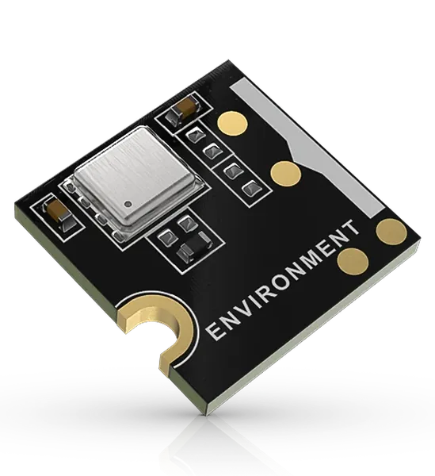

.. _rakwireless_rak1906:

RAK1906 WisBlock Environmental Sensor Module
############################################

Overview
********

RAK1906 is a WisBlock module carrying a Bosch BME680, which reports temperature,
pressure, humidity and gas resistance. It mounts on a WisBlock Sensor Slot and
communicates over I2C at address 0x76. The module brings out no signal other than I2C,
power and ground, so one shield covers every Sensor Slot.

   RAK1906 WisBlock Environmental Sensor Module (Credit: RAKwireless)

More information about the module can be found at `RAK1906 WisBlock Environmental Sensor
Module`_.

Requirements
************

RAK1906 requires a WisBlock Base Board and a WisBlock Core module. The base board supplies
the I2C node this shield attaches to, so its shield must be listed first.

Programming
***********

List the base board shield before this one so the I2C node exists:

.. zephyr-app-commands::
   :zephyr-app: samples/sensor/pressure_polling
   :board: rak4631/nrf52840
   :shield: rakwireless_rak19007,rakwireless_rak1906
   :goals: build flash

References
**********

.. target-notes::

.. _RAK1906 WisBlock Environmental Sensor Module:
   https://docs.rakwireless.com/product-categories/wisblock/rak1906
