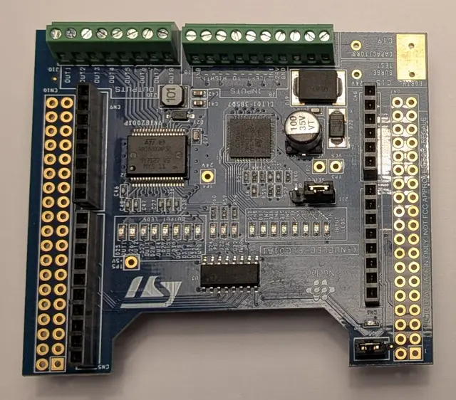

.. SPDX-FileCopyrightText: Copyright (c) 2026 Sebastian Balling
.. SPDX-License-Identifier: Apache-2.0

.. _x_nucleo_plc01a1_shield:

X-NUCLEO-PLC01A1 industrial input/output expansion board
########################################################

Overview
********

The X-NUCLEO-PLC01A1 is an industrial digital input/output expansion board
for STM32 Nucleo boards with an Arduino UNO R3 connector. It provides eight
24 V digital outputs and eight 24 V digital inputs, both galvanically
isolated from the MCU and connected over SPI.

   X-NUCLEO-PLC01A1 (Credit: Sebastian Balling)

More information about the expansion board is available on the
`X-NUCLEO-PLC01A1 product page`_.

Hardware Description
********************

- VNI8200XP octal high-side smart power solid state relay (8 outputs,
  up to 1 A per channel), with over-temperature, power good and DC-DC
  diagnostics.
- CLT01-38SQ7 octal digital input current limiter (8 inputs, IEC 61131-2
  type 1 and 3), with undervoltage and over-temperature alarms.
- Both chips use 16-bit SPI frames protected by parity/check bits.
- The board requires an external 24 V field supply. Without it, the SPI
  frames are invalid and the drivers report ``-EIO``.

Both chips are exposed as GPIO controllers:

+-----------------------+----------------------+----------------------------+
| Node label            | Compatible           | Pins                       |
+=======================+======================+============================+
| ``plc01a1_outputs``   | ``st,vni8200xp``     | 0..7 = OUT1..OUT8 (output) |
+-----------------------+----------------------+----------------------------+
| ``plc01a1_inputs``    | ``st,clt01-38sq7``   | 0..7 = IN1..IN8 (input)    |
+-----------------------+----------------------+----------------------------+

Pin Assignment
==============

+-------------+--------------------------------------------+
| Arduino pin | Function                                   |
+=============+============================================+
| D13         | SPI SCK                                    |
+-------------+--------------------------------------------+
| D12         | SPI MISO                                   |
+-------------+--------------------------------------------+
| D11         | SPI MOSI                                   |
+-------------+--------------------------------------------+
| D10         | SPI CS2 (VNI8200XP)                        |
+-------------+--------------------------------------------+
| D9          | SPI CS1 (CLT01-38SQ7) and VNI8200XP WD     |
+-------------+--------------------------------------------+
| D6          | VNI8200XP OUT_EN                           |
+-------------+--------------------------------------------+

Watchdog
========

The VNI8200XP watchdog is enabled on this board (period 160 ms nominal,
120 ms worst case). Its WD input is wired to the chip select of the
CLT01-38SQ7, so every read of the inputs also refreshes the watchdog.
An application that drives outputs must read the inputs at least every
~100 ms, otherwise the VNI8200XP switches all outputs off.

Requirements
************

This shield can be used with any board that provides an Arduino UNO R3
connector with the ``arduino_header`` and ``arduino_spi`` node labels.

.. note::

   On the :zephyr:board:`nucleo_f429zi` and :zephyr:board:`nucleo_f439zi`,
   Arduino D11 (PA7) is shared with the Ethernet RMII interface. To use the
   shield together with Ethernet, move SPI1 MOSI to PB5 (solder bridge SB121
   off, SB122 on) and override the pin control in a board overlay:

   .. code-block:: devicetree

      &spi1 {
              pinctrl-0 = <&spi1_sck_pa5 &spi1_miso_pa6 &spi1_mosi_pb5>;
      };

Programming
***********

Set ``--shield x_nucleo_plc01a1`` when you invoke ``west build``. For
example, the outputs and inputs can be tested with the GPIO shell:

.. zephyr-app-commands::
   :zephyr-app: samples/subsys/shell/shell_module
   :board: nucleo_f439zi
   :shield: x_nucleo_plc01a1
   :gen-args: -DCONFIG_GPIO=y -DCONFIG_SPI=y -DCONFIG_GPIO_SHELL=y
   :goals: build

.. code-block:: console

   uart:~$ gpio set gpio@0 0 1
   uart:~$ gpio get gpio@1 0

References
**********

.. target-notes::

.. _X-NUCLEO-PLC01A1 product page:
   https://www.st.com/en/ecosystems/x-nucleo-plc01a1.html
