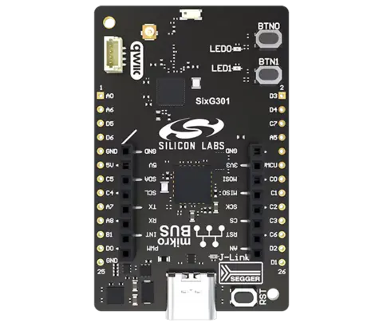

.. zephyr:board:: simg301_ek2719a

Overview
********

The SixG301 Explorer Kit (BRD2719A) is a development platform based on the
Silicon Labs SIMG301M104LIL wireless SoC. It supports the development of
2.4 GHz wireless IoT applications.

The kit provides an on-board SEGGER J-Link debugger, a USB virtual COM port,
two user LEDs, two push buttons, GPIO breakout pads, a mikroBUS socket and a
Qwiic connector.

   SixG301 Explorer Kit (BRD2719A) (Credit: Silicon Labs)

Hardware
********

- SoC: SIMG301M104LIL
- CPU: Arm Cortex-M33 with FPU
- Maximum CPU frequency: 150 MHz
- Flash: 4 MB physical flash
- RAM: 512 KB
- Wireless frequency: 2.4 GHz
- On-board SEGGER J-Link debugger and USB virtual COM port
- mikroBUS socket and Qwiic connector

Supported Features
==================

.. zephyr:board-supported-hw::

System Clock
============

The system clock uses the SoC PLL configured for 150 MHz.

Serial Port
===========

EUSART0 is used for the console. The default pin configuration is:

- TX: PB2
- RX: PB0

The default console settings are 115200 baud, 8 data bits, no parity and
1 stop bit.

I2C
===

The default I2C0 pin configuration is:

- SDA: PC5
- SCL: PC4

Both pins are configured for open-drain operation with pull-up resistors.

Programming and Debugging
*************************

.. zephyr:board-supported-runners::

Flashing
========

Connect the BRD2719A Explorer Kit to the host computer using its USB
connector.

Build and flash the :zephyr:code-sample:`hello_world` sample:

.. zephyr-app-commands::
   :zephyr-app: samples/hello_world
   :board: simg301_ek2719a
   :goals: build flash

Open a serial terminal connected to the board's virtual COM port with these
settings:

- Baud rate: 115200
- Data bits: 8
- Parity: None
- Stop bits: 1

After resetting the board, the terminal should display:

.. code-block:: console

   Hello World! simg301_ek2719a

Debugging
=========

The board provides an on-board SEGGER J-Link debugger.

Use the J-Link runner to flash or debug applications. Depending on the
installed J-Link device database, the SIMG301M104LIL device alias may require
the Silicon Labs device definitions supplied with Simplicity Studio.

References
**********

- `SixG301 Explorer Kit product page`_
- `SixG301 Explorer Kit User's Guide`_
- `SIMG301 datasheet`_
- `SixG301 reference manual`_

.. _SixG301 Explorer Kit product page:
   https://www.silabs.com/development-tools/wireless/sixg301-explorer-kit

.. _SixG301 Explorer Kit User's Guide:
   https://www.silabs.com/documents/public/user-guides/ug626-brd2719a-user-guide.pdf

.. _SIMG301 datasheet:
   https://www.silabs.com/documents/public/data-sheets/simg301-datasheet.pdf

.. _SixG301 reference manual:
   https://www.silabs.com/documents/public/reference-manuals/sixg301-rm.pdf
