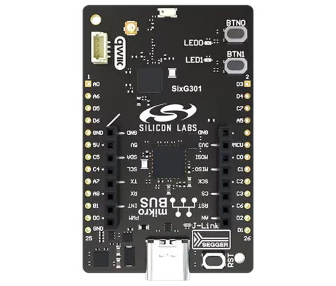

.. zephyr:board:: sixg301_ek2719a

Overview
********

The SixG301 Explorer Kit (BRD2719A) is a development platform based on the
Silicon Labs SIMG301M104LIL wireless SoC. It supports the development of
2.4 GHz wireless IoT applications.

The kit provides an on-board SEGGER J-Link debugger, a USB virtual COM port,
two user LEDs, two push buttons, GPIO breakout pads, a mikroBUS socket and a
Qwiic connector.

   SixG301 Explorer Kit (BRD2719A) (Credit: Silicon Labs)

Hardware
********

- SoC: SIMG301M104LIL
- CPU: Arm Cortex-M33 with FPU
- Maximum CPU frequency: 150 MHz
- Flash: 4 MB physical flash
- RAM: 512 KB
- Wireless frequency: 2.4 GHz
- On-board SEGGER J-Link debugger and USB virtual COM port
- mikroBUS socket and Qwiic connector

Supported Features
==================

.. zephyr:board-supported-hw::

System Clock
============

The system clock uses the SoC PLL configured for 150 MHz.

Serial Port
===========

EUSART0 is used for the console. The default pin configuration is:

- TX: PB2
- RX: PB0

The default console settings are 115200 baud, 8 data bits, no parity and
1 stop bit.

I2C
===

The default I2C0 pin configuration is:

- SDA: PC5
- SCL: PC4

Both pins are configured for open-drain operation with pull-up resistors.

Programming and Debugging
*************************

.. zephyr:board-supported-runners::

Memory Configuration
====================

The SiMG301 flash controller divides memory into 8 code regions and one data region. Code regions
are made up of 32 kB erasable pages used to store firmware images. The data region is made up of
4 kB erasable pages used to store data.

Code regions may be configured with no protection, EXiP (encrypted execute-in-place) or AXiP
(authenticated execute-in-place). When AXiP is enabled, an additional 4 bytes of MAC (message
authentication code) are stored for every 32 bytes of ciphertext. This means that 36 kB of physical
memory is consumed for every 32 kB of firmware. The MAC is not directly accessible, but must be
accounted for when calculating code and data region sizes. See `Configuring Code Regions`_ for
more information.

.. _Configuring Code Regions:
   https://docs.silabs.com/iot-security/latest/iot-security-series-3-axip/configuring-code-regions

In Zephyr, the partition configuration in Devicetree must align with the logical memory map as
configured on the device. Since the apparent logical size of memory varies depending on how many
flash pages are used for AXiP code regions, the total flash size must also be configured to match
the device configuration.

Configuring the Board for Development
-------------------------------------

When AXiP (authenticated execute-in-place) or EXiP (encrypted execute-in-place) are enabled, it is
recommended to configure development devices to not regenerate the IV (initial value) for flash
encryption every time an image is flashed, to limit the use of OTP (one-time-programmable memory)
bits.

This can be done by executing the following command using Simplicity Commander:

.. code-block:: console

   commander security transitiontodevelopment

See `Considerations for Development Devices`_ for more details. For more information about OTP bit
consumption, see `SE Anti-Rollback OTP Bit Consumption for Series 3`_.

.. _Considerations for Development Devices:
   https://docs.silabs.com/iot-security/latest/iot-security-series-3-axip/considerations-for-development-devices

.. _SE Anti-Rollback OTP Bit Consumption for Series 3:
   https://docs.silabs.com/iot-security/latest/iot-security-anti-rollback-series3

Flashing
========

Connect the BRD2719A Explorer Kit to the host computer using its USB
connector.

Build and flash the :zephyr:code-sample:`hello_world` sample:

.. zephyr-app-commands::
   :zephyr-app: samples/hello_world
   :board: sixg301_ek2719a
   :goals: build flash

Open a serial terminal connected to the board's virtual COM port with these
settings:

- Baud rate: 115200
- Data bits: 8
- Parity: None
- Stop bits: 1

After resetting the board, the terminal should display:

.. code-block:: console

   Hello World! sixg301_ek2719a/simg301m104lil

Bluetooth
=========

To use Bluetooth functionality, run the command below to retrieve necessary binary
blobs from the Silicon Labs HAL repository.

.. code-block:: console

   west blobs fetch hal_silabs

Then build the Zephyr kernel and a Bluetooth sample with the following
command. The :zephyr:code-sample:`bluetooth_observer` sample application is used in
this example.

.. zephyr-app-commands::
   :zephyr-app: samples/bluetooth/observer
   :board: sixg301_ek2719a
   :goals: build flash

Debugging
=========

The board provides an on-board SEGGER J-Link debugger. ``west flash`` uses
Simplicity Commander by default, and ``west debug`` uses J-Link.

References
**********

- `SixG301 Explorer Kit product page`_
- `SixG301 Explorer Kit User's Guide`_
- `SIMG301 datasheet`_
- `SixG301 reference manual`_

.. _SixG301 Explorer Kit product page:
   https://www.silabs.com/development-tools/wireless/sixg301-explorer-kit

.. _SixG301 Explorer Kit User's Guide:
   https://www.silabs.com/documents/public/user-guides/ug626-brd2719a-user-guide.pdf

.. _SIMG301 datasheet:
   https://www.silabs.com/documents/public/data-sheets/simg301-datasheet.pdf

.. _SixG301 reference manual:
   https://www.silabs.com/documents/public/reference-manuals/sixg301-rm.pdf
