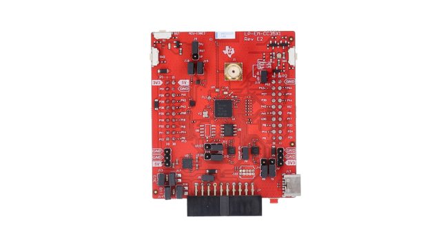

.. zephyr:board:: lp_em_cc35x1

Overview
********

The Texas Instruments SimpleLink CC35x1 LaunchPad
development kit, also referred to as LP-EM-CC35x1, is an evaluation board for
the CC35xxE wireless MCU family.

The board exposes the CC35xxE application core, wireless subsystem, external
flash and BoosterPack headers. Zephyr models it as a multi-SoC board and uses
board qualifiers to select the CC35xxE device variant.

See the `TI CC35x1 LaunchPad Product Page`_ for details about the hardware.

Board Identifiers
=================

The following board identifiers are supported:

+--------------------------+---------+-----------+---------------+
| Board Identifier         | Device  | Wi-Fi     | Bluetooth LE  |
+==========================+=========+===========+===============+
| ``lp_em_cc35x1/cc3500e`` | CC3500E | 2.4 GHz   | No            |
+--------------------------+---------+-----------+---------------+
| ``lp_em_cc35x1/cc3501e`` | CC3501E | 2.4 GHz   | Yes           |
+--------------------------+---------+-----------+---------------+
| ``lp_em_cc35x1/cc3550e`` | CC3550E | 2.4/5 GHz | No            |
+--------------------------+---------+-----------+---------------+
| ``lp_em_cc35x1/cc3551e`` | CC3551E | 2.4/5 GHz | Yes           |
+--------------------------+---------+-----------+---------------+

Hardware
********

The CC35xxE wireless MCU family includes an Arm Cortex-M33 application core
running at up to 160 MHz and an integrated wireless subsystem. Depending on the
selected device variant, the wireless subsystem supports 2.4 GHz Wi-Fi, 5 GHz
Wi-Fi and Bluetooth Low Energy.

The LP-EM-CC35x1 board has:

* CC35xxE wireless MCU
* External serial flash used for boot, application images and wireless
  subsystem content
* Two user LEDs
* Two user push buttons
* BoosterPack headers for expansion
* UART console routed through the board debug interface
* Debug connector for an external XDS110-based debug probe

The board needs a flash layout compatible with the SimpleLink Wi-Fi Toolbox.
Zephyr uses the toolbox during build and flash steps to generate the signed
vendor image and configuration files used by the CC35xx boot flow.

Supported Features
==================

.. zephyr:board-supported-hw::

Connections and IOs
===================

The default Zephyr console uses ``uart1`` and the following serial settings:

+----------+--------+
| Setting  | Value  |
+==========+========+
| Baudrate | 115200 |
+----------+--------+
| Data     | 8 bits |
+----------+--------+
| Parity   | None   |
+----------+--------+
| Stop     | 1 bit  |
+----------+--------+

The default on-board user devices are:

+--------------+---------+---------------+
| Zephyr alias | Signal  | Usage         |
+==============+=========+===============+
| ``led0``     | GPIO 34 | Red LED       |
+--------------+---------+---------------+
| ``led1``     | GPIO 35 | Blue LED      |
+--------------+---------+---------------+
| ``sw0``      | GPIO 2  | User button 1 |
+--------------+---------+---------------+
| ``sw1``      | GPIO 36 | User button 2 |
+--------------+---------+---------------+

The default UART pin assignments are:

+-----------+--------+--------+
| UART      | TX pin | RX pin |
+===========+========+========+
| ``uart0`` | P17    | P18    |
+-----------+--------+--------+
| ``uart1`` | P5     | P6     |
+-----------+--------+--------+

Flash Configuration
===================

The board support contains SimpleLink Wi-Fi Toolbox flash profiles for several
external serial flash parts. The default Zephyr configuration selects the
``is25wj032f`` profile.

Applications that use a different flash device must select the matching
``CONFIG_CC35XXE_FLASH_PROFILE_*`` Kconfig option at build time. For example,
an application using an IS25WJ064F flash can add the following to an
application configuration file:

.. code-block:: cfg

   CONFIG_CC35XXE_FLASH_PROFILE_IS25WJ064F=y

Boards with an 8 MB flash layout should also include the board overlay:

.. code-block:: console

   -DEXTRA_DTC_OVERLAY_FILE=boards/ti/lp_em_cc35x1/lp_em_cc35x1_8m.overlay

The selected flash profile is used by the SimpleLink Wi-Fi Toolbox image
generation step and by ``west flash --initial-programming``.

Programming and Debugging
*************************

Prerequisites
=============

Install the SimpleLink Wi-Fi Toolbox and put the ``simplelink-wifi-toolbox``
executable in ``PATH``. The Zephyr runner uses this tool to generate and flash
CC35xx images.

The board also requires an external debug probe such as LP-XDS110 or
LP-XDS110ET.

Runner Support
==============

.. zephyr:board-supported-runners::

The ``simplelink_toolbox`` runner uses the SimpleLink Wi-Fi Toolbox for image
programming. Debug commands first switch the device into debug mode through the
toolbox, then start an OpenOCD session using the board support files.

Building
========

Build :zephyr:code-sample:`hello_world` for the CC3551E target:

.. zephyr-app-commands::
   :zephyr-app: samples/hello_world
   :board: lp_em_cc35x1/cc3551e
   :goals: build

The build generates the Zephyr ELF file and the SimpleLink Toolbox flash
artifacts under the build directory:

.. code-block:: console

   build/zephyr/flash/vendor_image.sign.bin
   build/zephyr/flash/cc35xx-conf.bin

Initial Programming
===================

Use initial programming after a full flash erase, when changing the flash
profile, or when programming a board that does not already contain a compatible
CC35xx boot and flash layout.

.. code-block:: console

   west flash --initial-programming

This performs factory programming through the SimpleLink Wi-Fi Toolbox using
the flash profile selected at build time.

Flashing
========

After a compatible flash layout has been programmed, applications can be updated
with the regular flash command:

.. zephyr-app-commands::
   :zephyr-app: samples/hello_world
   :board: lp_em_cc35x1/cc3551e
   :goals: flash

Serial Console
==============

Connect a serial terminal to the XDS110 UART port exposed by the board. On a
Linux host this is typically one of the ``/dev/ttyACM*`` devices:

.. code-block:: console

   minicom -D /dev/ttyACM0 -b 115200

Reset the board after flashing. A successful :zephyr:code-sample:`hello_world`
boot prints:

.. code-block:: console

   Hello World! lp_em_cc35x1/cc3551e

Debugging
=========

Start an OpenOCD-based debug session with:

.. zephyr-app-commands::
   :zephyr-app: samples/hello_world
   :board: lp_em_cc35x1/cc3551e
   :maybe-skip-config:
   :goals: debug

References
**********

.. target-notes::

.. _TI CC35x1 LaunchPad Product Page:
   https://www.ti.com/tool/LP-EM-CC35X1

.. _TI CC3551E Product Page:
   https://www.ti.com/product/CC3551E
