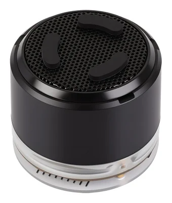

.. SPDX-FileCopyrightText: Copyright The Zephyr Project Contributors
.. SPDX-License-Identifier: Apache-2.0

.. zephyr:board:: esp32s3_audio

Overview
********

The `ESP32-S3-AUDIO-Board`_ from Waveshare is an ESP32-S3R8 development board with
16 MB flash, 8 MB octal PSRAM, two microphones, a speaker connector, seven RGB LEDs,
a real-time clock, and a microSD slot. It also exposes display and camera connectors.

This board definition uses the wiring in the `version 1.1 schematic`_.
Board photographs courtesy of Waveshare.

Hardware
********

.. include:: ../../../espressif/common/soc-esp32s3-features.rst
   :start-after: espressif-soc-esp32s3-features

Supported Features
==================

.. zephyr:board-supported-hw::

Connections
===========

.. list-table:: Onboard connections
   :header-rows: 1
   :widths: 35 65

   * - Function
     - Connection
   * - USB Serial/JTAG console
     - GPIO19 (D-), GPIO20 (D+)
   * - UART0
     - GPIO43 (TX), GPIO44 (RX); disabled by default
   * - I2C0
     - GPIO10 (SCL), GPIO11 (SDA)
   * - TCA9555 GPIO expander
     - I2C address 0x20
   * - PCF85063A RTC
     - I2C address 0x51
   * - BOOT button (``sw0``)
     - GPIO0, active low
   * - KEY1, KEY2, KEY3 (``sw1``, ``sw2``, ``sw3``)
     - Expander pins 9, 10, 11, active low
   * - WS2812B RGB LED ring (``led-strip``)
     - GPIO38, seven LEDs driven by RMT channel 0
   * - microSD (one-bit SDMMC)
     - GPIO40 (CLK), GPIO41 (D0), GPIO42 (CMD)
   * - SPI display connector
     - GPIO3 (CS), GPIO4 (CLK), GPIO8 (MISO), GPIO9 (MOSI)
   * - DVP camera connector
     - GPIO2, 17, 18, 39, 45, 46, 47, 48 (D0-D7), GPIO1 (HREF), GPIO21 (VSYNC),
       GPIO43 (XCLK), GPIO44 (PCLK), I2C0 (SCCB), expander pin 5 (PWDN)
   * - I2S0
     - GPIO12 (MCLK), GPIO13 (BCLK), GPIO14 (LRCLK), GPIO15 (RX), GPIO16 (TX)

The TCA9555 uses the PCA9555 driver through its register-compatible fallback.
The expander interrupt is not connected on the stock board (R15 is unpopulated),
so KEY1 through KEY3 use polling. The RTC interrupt is connected to expander pin 4;
RTC alarm interrupts are not configured.

:kconfig:option:`CONFIG_GPIO_PCA_SERIES_INTERRUPT` defaults to ``n`` on this board.
An application that connects the expander interrupt must both enable this option and
provide ``int-gpios`` in its devicetree overlay.

The GPIO expander is disabled by default in MCUboot builds for this board because
the bootloader does not use it. This also keeps the expander's semaphore-based
initialization out of the default threadless bootloader.

The SD card slot is wired for one-bit operation. DAT1 and DAT2 are not connected to
the ESP32-S3, and DAT3 is connected to expander pin 3.

RTC and microSD
===============

Enable :kconfig:option:`CONFIG_RTC` to access the PCF85063A through the ``rtc`` alias.
The driver supports setting and reading time. With :kconfig:option:`CONFIG_RTC_ALARM`,
applications can configure an alarm and poll :c:func:`rtc_alarm_is_pending` without
an interrupt connection. For interactive time access, enable
:kconfig:option:`CONFIG_SHELL` and :kconfig:option:`CONFIG_RTC_SHELL`.

The microSD slot supports reads and writes through the disk named ``SD``. Applications
using FatFs can mount it at ``/SD:`` with the following configuration:

.. code-block:: cfg

   CONFIG_DISK_ACCESS=y
   CONFIG_FILE_SYSTEM=y
   CONFIG_FAT_FILESYSTEM_ELM=y
   CONFIG_FS_FATFS_MOUNT_MKFS=n

Enable :kconfig:option:`CONFIG_FS_FATFS_EXFAT` for an exFAT-formatted card.
See :zephyr:code-sample:`fs` for filesystem API usage.

Audio
=====

The ES8311 codec drives the speaker through an NS4150B amplifier, and the ES7210 ADC
captures the two microphones. ES7210 input MIC3 is wired to the speaker path as an echo
cancellation reference. Both devices share I2S0 and I2C0:

.. list-table:: Audio connections
   :header-rows: 1
   :widths: 35 65

   * - Signal
     - Connection
   * - MCLK, BCLK, LRCLK
     - GPIO12, GPIO13, GPIO14, shared by both devices
   * - Playback data
     - GPIO16 to ES8311 DSDIN
   * - Capture data
     - ES7210 SDOUT1 to GPIO15
   * - Control
     - I2C0, ES8311 at 0x18, ES7210 at 0x40
   * - Amplifier enable
     - Expander pin 8, active high

Neither device has a Zephyr driver yet, so the board definition does not instantiate them
and speaker playback and microphone capture are not supported. The ESP32-S3 generates all
clocks; an application configuring the devices through the audio codec API sets
``I2S_OPT_BIT_CLK_TARGET`` and ``I2S_OPT_FRAME_CLK_TARGET`` in the codec configuration.

The board pinctrl routes the I2S0 transmit clocks to GPIO13 and GPIO14, so BCLK and LRCLK
run only while the transmitter runs. Capture with this pinctrl requires ``I2S_DIR_BOTH``,
with silent blocks queued for transmission when nothing is playing; the driver stops the
stream when the transmit queue runs empty. With ``I2S_DIR_RX`` alone, no clocks reach the
devices and all captured samples are zero.

For capture without playback, an application overlay can select ``I2S0_I_BCK_GPIO13`` and
``I2S0_I_WS_GPIO14`` and use ``I2S_DIR_RX``. This route does not capture with
``I2S_DIR_BOTH``, so it cannot be combined with playback. After using ``I2S_DIR_BOTH``,
configure both directions with a zero ``frame_clk_freq`` before configuring ``I2S_DIR_RX``.

The ESP32-S3 I2S driver supports two channels, so capture uses one ES7210 output pair, such
as MIC1 and MIC2. Capturing the MIC3 reference together with both microphones requires
four-channel TDM, which the driver does not support.

Display and camera
==================

An attached display or camera requires an application overlay. The display connector
uses GPIO7 for D/C, GPIO5 for backlight control, and expander pin 0 for reset.
Expander pin 6 selects the camera clock signals. A high level routes camera XCLK and PCLK
to GPIO43 and GPIO44, respectively; keep UART0 disabled when using this route. A low level routes
them to GPIO20 and GPIO19; disable USB Serial/JTAG and move the console when using that route.

Battery voltage measurement requires soldering the optional resistor shown in the
schematic and conflicts with the camera HREF signal on GPIO1. It is not enabled.

Overlays
--------

Create an ``app.overlay`` in the application directory for the attached module, using
the connector wiring above and the module's binding. No display or camera sensor is
instantiated by the board definition, and camera capture remains disabled.
The camera connector has been tested with an OV2640 module. The display connector
has not been tested.

For a display, add its controller node under ``spi2`` or a MIPI DBI bus as required by
the panel binding. Configure reset, D/C, and backlight control for the panel, and set
``zephyr,display`` in ``/chosen`` to the display node.

For a camera, add its sensor node on ``i2c0`` with ``pwdn-gpios`` on expander pin 5, a
``lcd_cam`` pinctrl group for the camera pins above, and the sensor source and endpoint
connections for ``lcd_cam_dvp``. Expander pin 6 must be high before the sensor initializes,
for example through a ``gpio-hog`` with :kconfig:option:`CONFIG_GPIO_HOGS` enabled and
:kconfig:option:`CONFIG_GPIO_HOGS_INIT_PRIORITY` set between the expander and
:kconfig:option:`CONFIG_VIDEO_INIT_PRIORITY`. Set ``zephyr,camera`` in ``/chosen`` to
``lcd_cam_dvp``.

System Requirements
*******************

.. include:: ../../../espressif/common/system-requirements.rst
   :start-after: espressif-system-requirements

Programming and Debugging
*************************

.. zephyr:board-supported-runners::

.. include:: ../../../espressif/common/building-flashing.rst
   :start-after: espressif-building-flashing

Board-specific configuration
============================

Connect the USB Type-C port to the host. The default console uses the built-in USB
Serial/JTAG controller. UART0 is disabled because the default camera/USB switch setting
does not expose its GPIO43/GPIO44 route. An application using an external UART adapter
must configure the switch and resolve the USB/camera pin conflicts before enabling
``uart0`` in an overlay. Alternatively, an overlay can disable ``spi2`` and route UART0
to GPIO4 (TX) and GPIO8 (RX) on the expansion header; this route has been tested in
loopback. UART transfers on GPIO43/GPIO44 have not been tested.

If the board does not enter download mode automatically, hold BOOT, press and release
RESET, then release BOOT before flashing.

The :zephyr:code-sample:`led-strip` sample drives the seven RGB LEDs, and
:zephyr:code-sample:`input-dump` reports events from BOOT and the three user buttons.

Sysbuild selects MCUboot by default. The 16 MB flash layout reserves 64 KB at offset 0
for MCUboot, with primary and secondary slots at offsets 0x20000 and 0x5f0000. Each slot
is 5952 KB. Separate partitions are reserved for the APPCPU and low-power core images.

Sysbuild uses MCUboot's development key by default. Set ``SB_CONFIG_BOOT_SIGNATURE_KEY_FILE``
to select an application-specific signing key.
To validate the primary image on every boot, enable ``CONFIG_BOOT_VALIDATE_SLOT0`` in
the application's ``sysbuild/mcuboot.conf``. The ESP32-S3 MCUboot defaults disable this check.

AMP applications
================

The ``esp32s3_audio/esp32s3/appcpu`` target is for a secondary image started by
PROCPU in an AMP application. It has no standalone console. See the
:zephyr:code-sample:`ipm-esp32` sample for an application using both cores.

.. include:: ../../../espressif/common/board-variants.rst
   :start-after: espressif-board-variants

Debugging
=========

.. include:: ../../../espressif/common/openocd-debugging.rst
   :start-after: espressif-openocd-debugging

References
**********

.. _ESP32-S3-AUDIO-Board: https://docs.waveshare.com/ESP32-S3-AUDIO-Board
.. _version 1.1 schematic: https://files.waveshare.com/wiki/ESP32-S3-AUDIO-Board/ESP32-S3-AUDIO-Board_1.1.pdf
