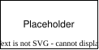

.. _safety_process-verif_test:

Verification Test
#################

Document Identification
***********************

.. list-table::
   :header-rows: 1
   :width: 100%

   * - Version
     - Status
     - Release date (DD/MM/YYYY)
     - Review & Approval

   * - 1.0
     - Draft
     - 18/09/2026
     - See merge request history [#f1]_

.. [#f1] Refer to Configuration & Change Management process for how to identify commit and merge request related to a release.

Version history
***************

.. list-table::
   :header-rows: 1
   :widths: 10 90
   :width: 100%

   * - Version
     - Reason for change

   * - 1.0
     - Initial release

Process
*******

Purpose & Scope
===============

The verification test process aims at defining when and how shall contributors develop and perform verification test activities.
This process also defines activities to be performed when test is not the appropriate mean to verify a requirement (e.g. verification through inspection or analysis).

This process is applicable to Zephyr project safety releases and applies to all of the software life cycle data, software tools and hardware tools produced and used throughout the development life cycle.

Overview
========

   Verification test activity diagram

.. tabs::

   .. group-tab:: Entry

      #. New development artifact (requirement, architecture, design)
      #. Updated development artifact (requirement, architecture, design)

   .. group-tab:: Input

      #. Development artifact

   .. group-tab:: Activities

      #. Develop test cases
      #. Develop & execute test procedures
      #. Perform verification through inspection
      #. Perform verification through analysis

   .. group-tab:: Output

      #. Test cases
      #. Procedures

   .. group-tab:: Exit

      #. Test cases, procedures, inspection and analysis are in configuration management
      #. Test results are documented
      #. Issues resulting from this process are resolved
      #. Non-resolved issues are logged and marked as non-gating
      #. Test cases, procedures, inspection and analysis are released

   .. group-tab:: Tools

      .. list-table::
        :header-rows: 1
        :width: 100%

        * - Tool
          - Purpose
          - Location

        * - Git
          - Test cases and procedures repository
          - https://github.com/zephyrproject-rtos/<REPOSITORY>/pulls

   .. group-tab:: R & R
      .. list-table::
        :header-rows: 1
        :width: 100%

        * - Role
          - Responsibilities

        * - Contributor
          - Develops and submits test cases and procedures for review and merge

        * - Maintainer
          - Review and approves changes

Activities
==========

Develop test cases
------------------

Test cases shall be documented using doxygen as follows:

.. code-block:: c
   :caption: Template for test case documentation

    /**
    * @brief Test case title
    *
    * @details
    * Purpose: Test case purpose and what it is verifying.
    * Initial conditions: Hardware dependencies, Kconfig options, thread priorities, device state.
    *
    * Test steps:
    * 1. Do something.
    * 2. Do something else.
    * 3. Do another thing.
    *
    * Expected result:
    * 1. Something happens.
    * 2. Something else happens.
    *
    * @verifies SOME_API
    * @verifies ZEP-REQ-1-0-1
    */

.. code-block:: c
   :caption: Example of test case documentation: Semaphore synchronization test case

    /**
    * @brief Verify a semaphore synchronizes two threads.
    *
    * @details
    * A semaphore is used to hand off execution between two threads, exercising both
    * a run-time initialized semaphore (k_sem_init()) and a compile-time defined one
    * (K_SEM_DEFINE()). One thread gives the semaphore while the other takes it,
    * confirming that a run-time defined semaphore is usable for synchronization.
    *
    * Test steps:
    * - Initialize a semaphore at run time with k_sem_init().
    * - Hand off between two threads via k_sem_give()/k_sem_take().
    * - Repeat the hand off using a compile-time K_SEM_DEFINE() semaphore.
    *
    * Expected result:
    * - Both threads synchronize correctly using either semaphore.
    *
    * @verifies K_SEM_DEFINE
    * @verifies ZEP-SRS-5-2
    */

Test cases shall be developed such that they cover all possible scenarios from a requirement or set of requirements.

Test cases may be grouped into test suites, which are collections of test cases that are related to a specific requirement or group of requirements.

.. code-block:: c
   :caption: Template for test suite documentation

    /**
    * @brief Test suite title
    * @defgroup test_suite_id Test suite title displayed in the documentation
    * @ingroup parent_test_suite_id
    * @{
    */

    // SOME TEST CASES

    /**
    * @}
    */

.. code-block:: c
   :caption: Example of test suite documentation: Semaphore test suite

    /**
    * @defgroup kernel_semaphore_tests Semaphores
    * @ingroup all_tests
    * @{
    */

    // SOME SEMPAHORE TEST CASES

    /**
    * @}
    */

.. list-table:: Activity Audit & Review checklist
        :header-rows: 1
        :widths: 10 50 40
        :width: 100%

        * - ID
          - Checklist item
          - Example (optional)

        * - -
          - **Review chekpoints for each test case**
          - -

        * - 1
          - Does the test have an identifier and is this identifier unique?
          - None

        * - 2
          - Is the test linked to at least one requirement?
          - At least a requirement ID is tagged

        * - 3
          - Does each linked requirement exist and is the test case referring to its current version?
          - None

        * - 4
          - Does the test case verify a portion of the behavior described in the linked requirement?
          - None

        * - 5
          - Are the preconditions, initial state and configuration of the test case defined?
          - Hardware dependencies, Kconfig options, thread priorities, device state

        * - 6
          - Are the test case inputs defined, including boundary values?
          - None

        * - 7
          - Are the expected test case results stated with objective and unambiguous pass/fail criteria?
          - None

        * - 8
          - Is the test case repeatable, giving the same result on every run?
          - No dependence on timing, luck or uninitialized memory

        * - 9
          - Is the test case atomic?
          - Independent of other tests and no dependence on execution order

        * - 10
          - Are the test environment and target identified, and is it justified if the target is a simulator or emulator?
          - Board name, ``native_sim``, QEMU

        * - 11
          - Does the test check observable behavior rather than depend on implementation details not in the requirement?
          - None

        * - 12
          - Is the test uniquely identified and under version control?
          - None

        * - 13
          - Has the test been reviewed by someone other than its author?
          - None

        * - -
          - - **Review chekpoints looking at a group of test cases**
          - -

        * - 1
          - Does the test case set verify the complete behavior stated in the linked requirements, not only part of it?
          - None

        * - 2
          - Does every requirement in scope have at least one test case (requirement coverage)?
          - None

        * - 3
          - Are there test cases not traced to any requirement, and is each one justified or removed?
          - None

        * - 4
          - Are any requirement coverage gaps documented with a rationale?
          - None

        * - 5
          - Do the test cases cover normal operation, boundary values and error conditions for each requirement?
          - None

Develop & execute test procedures
---------------------------------

Test procedures shall be developed according to the test case specifications.

.. list-table:: Activity Audit & Review checklist
        :header-rows: 1
        :widths: 10 50 40
        :width: 100%

        * - ID
          - Checklist item
          - Example (optional)

        * - -
          - **Review chekpoints for each test case**
          - -

        * - 1
          - Is the test procedure implementing the test cases?
          - None

        * - 2
          - Is the test procedure execution result a PASS?
          - None

        * - 3
          - Is the structural coverage target achieved?
          - Statement, branch and/or MC/DC coverage

        * - 4
          - Are the test results recorded and traceable to a specific software baseline?
          - CI run ID, commit hash

Perform verification through analysis
-------------------------------------

When a requirement cannot be verified through test, it may be verified through analysis.
The analysis shall be documented and reviewed.

.. admonition:: WIP
   :class: warning

   To be documented by the safety committee: Analysis process and record location

Perform verification through inspection
---------------------------------------

Test cases shall be documented using doxygen as follows:

.. admonition:: WIP
   :class: warning

   To be documented by the safety committee: Inspection process, checklist version/location, record location
