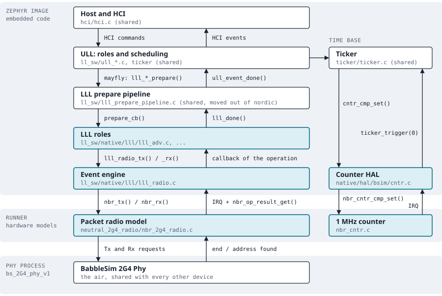
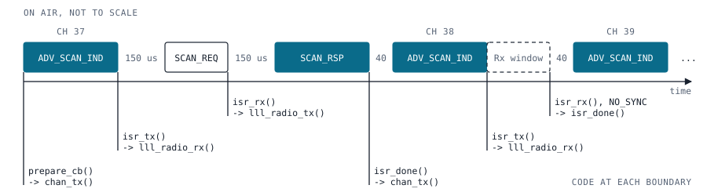
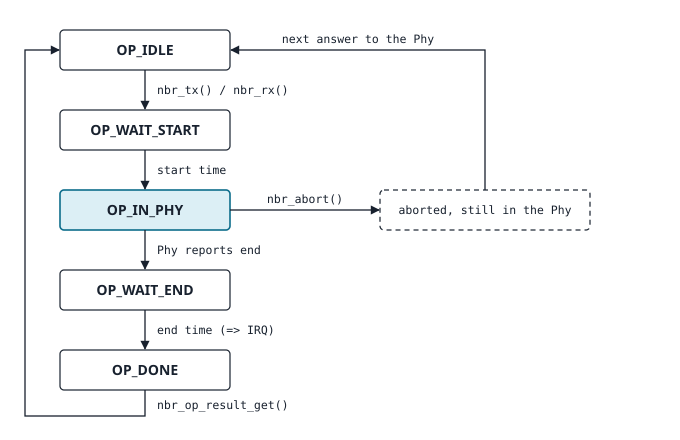

.. _bluetooth-ctlr-bsim-lll:

BabbleSim LLL
#############

Overview
********

Zephyr's open source :ref:`LE Controller <bluetooth-ctlr-arch>` is split into an Upper Link Layer
(ULL), which owns the roles and their scheduling, and a HW dependent Lower Link Layer (LLL), which
runs each radio event.

The BabbleSim LLL is a HW agnostic LLL that uses a vendor neutral, packet level, SW radio model,
instead of models of a particular vendor's radio peripheral. This LLL can be used with
:ref:`BabbleSim boards <bsim boards>`.

This LLL uses this radio model to transmit and receive packets, and gets an interrupt when either
has ended.

The LLL is in :zephyr_file:`subsys/bluetooth/controller/ll_sw/native`, and the radio model in
:zephyr_file:`boards/native/nrf_bsim/neutral_2g4_radio`.

Layers
******

   Calls going down are on the left, what comes back is on the right. The tinted boxes are specific
   to the BabbleSim LLL.

One simulated device is one process, in which the Zephyr image and the hardware models are linked
together. The models are part of the native simulator runner. The BabbleSim 2G4 Phy is another
process, which simulates the air for all devices.

Everything above the roles is the code that every LLL runs on. The LLL prepare pipeline, the
advertising PDU buffers and the checks of a received ``SCAN_REQ`` are common code in
:zephyr_file:`subsys/bluetooth/controller/ll_sw`, which the LLLs share.

Only two interfaces cross from the Zephyr image into the runner:

* :zephyr_file:`boards/native/nrf_bsim/neutral_2g4_radio/nbr_2g4_radio_if.h`: the radio model.
* :zephyr_file:`boards/native/nrf_bsim/neutral_2g4_radio/nbr_cntr_if.h`: a free running 1 MHz
  counter with one compare, which the ticker runs on.

Handoffs between the layers
===========================

The table follows an advertising PDU from the Host to the air, and its result back up.

.. list-table::
   :header-rows: 1
   :widths: 20 55 25

   * - From, to
     - Function
     - Context
   * - Host to ULL
     - ``ll_adv_enable()`` starts a ticker for the advertising set.
     - Host thread
   * - ULL to LLL
     - The ticker expiry runs ``ticker_cb()`` in ``ull_adv.c``, which queues ``lll_adv_prepare()``
       as a mayfly.
     - ULL high, then LLL
   * - Pipeline to role
     - ``lll_prepare_resolve()`` decides whether the event can start now, and calls
       ``prepare_cb()`` in ``lll_adv.c``.
     - LLL
   * - Role to event engine
     - ``chan_tx()`` picks the channel and the latest PDU, and calls ``lll_radio_tx()`` with a
       start time and a callback.
     - LLL, later the radio ISR
   * - Event engine to model
     - ``nbr_tx()`` or ``nbr_rx()`` stores the request in the radio model and arms it.
     - Same as the caller
   * - Model to Phy
     - At the start time, ``radio_timer_triggered()`` sends the request to the Phy from
       ``tx_start()`` or ``rx_start()``.
     - Hardware event on the runner
   * - Model with Phy
     - ``tx_response_handle()`` and ``rx_response_handle()`` take the answer of the Phy. When the
       Phy waits for the device, ``phy_timer_triggered()`` answers it.
     - Hardware event on the runner
   * - Model to event engine
     - At the end time the model raises the radio interrupt. ``lll_radio_isr()`` reads the result
       with ``nbr_op_result_get()``.
     - Radio ISR
   * - Event engine to role
     - The callback given with the request: ``isr_tx()``, ``isr_rx()`` or ``isr_done()``. It
       requests the next packet of the event.
     - Radio ISR
   * - Role to ULL
     - ``ull_rx_put_sched()`` for a report, such as a scan request notification, and
       ``lll_isr_cleanup()`` at the end of the event, which reports it done with ``lll_done()``.
     - Radio ISR

The event engine, :zephyr_file:`subsys/bluetooth/controller/ll_sw/native/lll/lll_radio.c`, is what
a role uses instead of a radio HAL. It takes one operation at a time, and runs the callback of the
operation from the radio ISR, also when the operation was stopped or was requested too late to
start. A role therefore ends its event in one place.

An advertising event
********************

   A scannable advertising event. The filled blocks are transmitted by the advertiser.

An advertising event sends the advertising PDU on each enabled channel in turn. With scannable
advertising the role listens for a scan request after each PDU, and answers a request that passes
the checks with the scan response. Each packet is requested from the radio ISR at the end of the
previous one, with the time at which it starts:

* The receive window opens just before 150 us (T_IFS) after the end of the PDU. It closes with
  ``NBR_STATUS_NO_SYNC`` unless an access address was received in it.
* The scan response starts 150 us after the end of the scan request.
* The PDU on the next channel starts 40 us after the previous channel is done.

The radio model reads a PDU when its transmission starts, not when it is requested, so that
advertising data which is updated in between is still sent.

Radio model
***********

   The states of an operation of the radio model.

The model handles one operation of the embedded software at a time: a Tx or an Rx. The result of
an operation stays in the model until the embedded software reads it. Requesting an operation
while another one is pending, or while its result has not been read, is an error that stops the
simulation.

``nbr_abort()`` frees an operation that waits for its start, for its end, or for its result to be
read. An operation which the Phy is busy with cannot be taken back at once: the abort reaches the
Phy when the Phy asks the device whether it wants to continue, in a later simulation delta cycle
in that same microsecond. Before that, the embedded software can already request the next
operation, so the model keeps two operations.

Towards the Phy the model follows the same conventions as other simulated radio models, so that
devices on any model see compatible packets. The conventions are described in the
`documentation of the 2G4 Phy device interface
<https://github.com/BabbleSim/ext_2G4_libPhyComv1/blob/master/docs/README.md>`_.

In the model:

* A possible abort is evaluated again whenever another hardware event of the device is due, and
  answered from the last hardware event of that microsecond, after the CPU could abort.
* An address match is answered at the time the address ended.
* The received bytes reach the embedded software when the packet has ended.

The radio model appends the CRC to a transmitted PDU, and checks the CRC of a received one with
the CRC init of the receiver. Radio ramp-ups are not modeled: a start time is the time of the
first preamble bit on air. A MIC is part of the payload, which the LLL appends and checks.

Interrupts
**********

The Controller takes its interrupt lines from the :dtcompatible:`zephyr,bsim-2g4-radio` node:

.. list-table::
   :header-rows: 1
   :widths: 15 25 60

   * - Name
     - Priority
     - Use
   * - ``radio``
     - :kconfig:option:`CONFIG_BT_CTLR_LLL_PRIO`
     - End of a radio operation. The callbacks of the roles run here.
   * - ``lll``
     - :kconfig:option:`CONFIG_BT_CTLR_LLL_PRIO`
     - LLL mayflies, such as the prepare of an event.
   * - ``ull-high``
     - :kconfig:option:`CONFIG_BT_CTLR_ULL_HIGH_PRIO`
     - Counter compare, which drives the ticker, and the ULL high mayflies.
   * - ``ull-low``
     - :kconfig:option:`CONFIG_BT_CTLR_ULL_LOW_PRIO`
     - ULL low mayflies, when they do not share the ``ull-high`` line.

Time
****

There is one clock, the simulation time of the device in microseconds. The counter model gives it
to the ticker as a free running 1 MHz counter, and the radio model takes the start times of its
operations in it, so the LLL does not convert between a timer and the radio.

The models count the time in 64 bits. The ticker and the roles use the low 32 bits, which wrap
about every 71 minutes, and ``lll_radio.c`` and the counter HAL convert between the two.

The end times which the model reports are the microsecond after the end of the packet, so that
adding T_IFS to the end of a packet gives the start of its response.

Selecting the LLL
*****************

The :ref:`bt-ll-bsim snippet <snippet-bt-ll-bsim>` adds the
:dtcompatible:`zephyr,bsim-2g4-radio` node to the boards it supports, and enables this LLL:

.. code-block:: console

   west build -b nrf52_bsim -S bt-ll-bsim samples/bluetooth/beacon

Limitations
***********

* The radio model supports the LE 1M and LE 2M PHYs.
* The interface of the radio model does not depend on a vendor, but its implementation uses the
  BabbleSim integration and the interrupt controller of the nRF hardware models. So it is limited
  to only some bsim boards, which the :ref:`bt-ll-bsim snippet <snippet-bt-ll-bsim>` lists.
