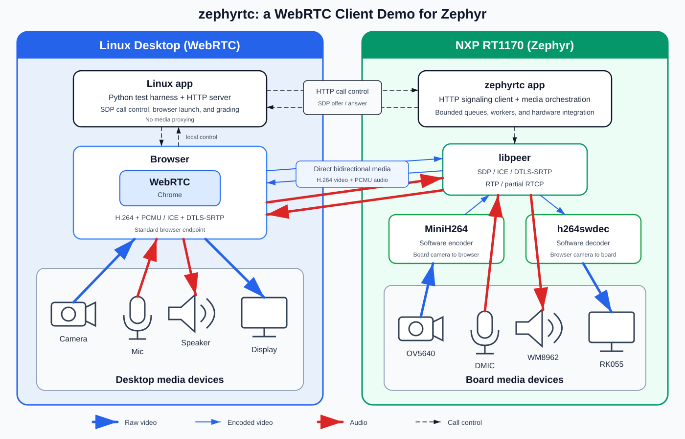

.. zephyr:code-sample:: zephyrtc
   :name: zephyrtc: a WebRTC Client Demo for Zephyr
   :relevant-api: video_interface display_interface i2s_interface

   Make a two-way audio and video WebRTC call between a Zephyr board and Chrome.

Overview
********

zephyrtc is a WebRTC client demo for Zephyr. On an NXP MIMXRT1170-EVKB it makes a full
bidirectional audio and video call with Google Chrome running on a desktop:

* Uplink video: the board camera (OV5640) to Chrome, as H.264.
* Uplink audio: the board microphones (DMIC) to Chrome, as PCMU (G.711).
* Downlink video: the Chrome camera to the board display (RK055), as H.264.
* Downlink audio: the Chrome microphone to the board headphone output (WM8962), as PCMU.

Video is 320x240 at 5 frames per second, H.264 Constrained Baseline, the profile WebRTC requires.
Audio is 8 kHz PCMU in 20 ms packets. Everything (WebRTC stack, DTLS-SRTP, H.264 encoding and
decoding, audio and display) runs on the 1 GHz Cortex-M7 core, without video hardware.

Rationale
=========

The main goal of zephyrtc is to show that a Zephyr board can run a WebRTC client that interoperates
with standard WebRTC peers. To prove compatibility, the demo makes a video call, with audio, to a
generic WebRTC client: the Chrome browser running on a separate device.

Media quality is sub-optimal: The board is relatively low-performance (the demo uses a single
Cortex-M7 core running at 1 GHz), and it encodes and decodes H.264 video in software. Video is
therefore limited to 320x240 at 5 frames per second, and audio to PCMU. Latency has not been
measured, but the call feels conversational.

Next steps:

* Replace PCMU with Opus for the audio RTP session.
* Port the media path to mpipe.

The main advantage of Opus will be better quality with less bitrate: Right now the
PCMU streams are narrowband (8 kHz) mono and using 64 kbps. We should be able to do
wideband audio (16 kHz) mono at 16-24 kbps with Opus. Note that the DMIC capture and
the WM8962 playback already run at 16 kHz. The cost is CPU, which needs to be
measured against the spare capacity in the Cortex-M7 core.

The mpipe port would have several advantages:

* Less application code. The hand-wired media path (camera capture, color conversion, codec
  threads, display, DMIC capture and SAI playback, and bounded queues) is most of the application;
  ``src/media_rt1170_zephyr.c`` alone is about 1,200 lines. With mpipe it becomes a pipeline of
  elements, and the application keeps only the signaling and the libpeer glue.
* Portability. RT1170-specific pieces, like the one-shot eDMA playback, would sit behind generic
  plugins, so another board would need configuration rather than a new media file.
* Reusable parts. Codec elements (MiniH264, h264swdec, and libopus if the audio session moves to
  Opus) and a libpeer RTP source and sink element would be useful well beyond zephyrtc.

The main disadvantage is that mpipe is still a moving target.

Architecture
============

* Signaling: the board is the SDP offerer. It sends its offer to a small HTTP signaling server on
  the desktop (``tests/physical_browser_call.py``), which passes it to the browser page and returns
  Chrome's answer. The server carries only the SDP.
* Media: ICE, DTLS-SRTP, RTP and RTCP then flow directly between Chrome and the board, through
  libpeer on top of Zephyr's sockets and Mbed TLS.
* Uplink video: OV5640 capture (video API), BGRX to I420 conversion, MiniH264 encoder, libpeer
  H.264 packetization.
* Downlink video: libpeer FU-A reassembly, h264swdec decoder, I420 to RGB565 conversion, display
  API. Packet loss triggers an RTCP PLI, and decoding resumes at the next IDR picture.
* Uplink audio: DMIC capture at 16 kHz, 8 kHz PCMU encoding, libpeer.
* Downlink audio: PCMU to PCM, played through the SAI to the WM8962 codec from a dedicated
  playback thread.

Dependencies
============

The sample uses three external modules, all listed in ``west.yml``:

* `libpeer <https://github.com/chemag/libpeer/tree/zephyrtc>`_ (MIT): the WebRTC stack. It also
  builds libsrtp from its ``third_party/libsrtp`` submodule.
* `MiniH264 <https://github.com/chemag/minih264/tree/zephyr-minimal>`_ (CC0-1.0): the H.264
  encoder, with its Zephyr glue in ``modules/minih264``.
* `h264swdec <https://github.com/chemag/h264swdec>`_ (Apache-2.0): the H.264 decoder, a standalone
  build of the Android H264SwDec decoder, with its Zephyr glue in
  ``modules/h264swdec``.

Requirements
************

Hardware:

* NXP MIMXRT1170-EVKB (board revision B).
* The 5 V power adapter in J43. Seat the plug fully: a loose plug causes resets under load.
* An OV5640 camera module (``nxp_btb44_ov5640`` shield) in the camera connector J2.
* A RK055HDMIPI4MA0 MIPI display panel (``rk055hdmipi4ma0`` shield).
* Headphones in J101. The microphones are on the board.
* A USB cable in J86, for the MCU-Link debug probe and the serial console.
* Ethernet: a cable in J32, on the same LAN as the desktop, with DHCP.
* Wi-Fi (optional): an Embedded Artists 2EL M.2 module (Murata LBES5PL2EL, NXP IW612) in J54,
  and an access point on the same LAN as the desktop, with DHCP.

Desktop:

* Linux with Google Chrome and Python 3.11 or newer.
* `NXP LinkServer <https://www.nxp.com/linkserver>`_, to flash the board.
* A firewall that accepts TCP connections to port 8080 from the board.

Setting up
**********

Create a west workspace from the ``zephyrtc`` branch, then install the Python requirements, the
Zephyr SDK and the IW612 Wi-Fi firmware from the NXP binary blobs:

.. code-block:: console

   west init -m https://github.com/chemag/zephyr --mr zephyrtc zephyrtc-workspace
   cd zephyrtc-workspace
   west update
   west packages pip --install
   west sdk install
   west blobs fetch hal_nxp --allow-regex 'nw61x/[^/]*$'
   pip install -r zephyr/samples/net/webrtc/zephyrtc/requirements.txt

See the `Getting Started Guide
<https://docs.zephyrproject.org/latest/develop/getting_started/index.html>`_ for details.

Configuring
***********

The build helper reads a private settings file. Copy the example, make it readable only by you
and edit it:

.. code-block:: console

   mkdir -p ~/.config/zephyrtc
   cp zephyr/samples/net/webrtc/zephyrtc/config/rt1170_demo.toml.example \
      ~/.config/zephyrtc/rt1170.toml
   chmod 600 ~/.config/zephyrtc/rt1170.toml

Set at least:

* ``network``: ``"ethernet"`` or ``"wifi"``.
* ``signaling_url``: the address of the desktop on the LAN, for example
  ``"http://192.168.1.10:8080/offer"``.
* ``wifi_ssid`` and ``wifi_password``, for Wi-Fi only.

``run_ms`` sets the call length on the board, and ``display_rotation`` and ``display_scale`` fit
the remote video to the panel. The helper refuses a settings file that other users can read,
and writes the generated Kconfig fragment, which holds the Wi-Fi credentials, next to it.
Nothing from this file goes into the source tree.

Building and flashing
*********************

Build with the helper. It selects the board, the shields, the overlays for the configured network
and the settings, and builds into ``build/zephyrtc-ethernet`` or
``build/zephyrtc-wifi``:

.. code-block:: console

   python3 zephyr/samples/net/webrtc/zephyrtc/tools/rt1170_demo.py

For Ethernet, the helper runs the equivalent of:

.. code-block:: console

   settings=$HOME/.config/zephyrtc/rt1170.generated.conf
   west build -p always -b mimxrt1170_evk@B/mimxrt1176/cm7 \
      --shield nxp_btb44_ov5640 --shield rk055hdmipi4ma0 \
      -d build/zephyrtc-ethernet zephyr/samples/net/webrtc/zephyrtc -- \
      -DEXTRA_CONF_FILE="overlay-mimxrt1170-av.conf;$settings"

For Wi-Fi, add ``overlay-mimxrt1170-wifi.conf`` to ``EXTRA_CONF_FILE`` and
``-DEXTRA_DTC_OVERLAY_FILE=boards/mimxrt1170_evk_mimxrt1176_cm7_B_wifi.overlay``.

Flash with LinkServer. If more than one board is connected, select the probe by its serial
number, as listed by ``LinkServer probes``:

.. code-block:: console

   west flash -d build/zephyrtc-ethernet -r linkserver --probe <serial>

The board starts its call as soon as it boots, so leave it for the next step: it has to boot
after the browser side is ready.

Running
*******

1. Open the serial console of the MCU-Link (115200 baud, 8N1).

2. Start the browser side on the desktop. It starts the signaling server on port 8080, launches
   Chrome and prints ``READY_FOR_RT1170`` when Chrome waits for the offer:

   .. code-block:: console

      cd zephyr/samples/net/webrtc/zephyrtc
      python3 tests/physical_browser_call.py --output-dir /tmp/zephyrtc-call \
         --headed --real-media --timeout 150 --connected-seconds 100

   Without ``--real-media``, Chrome sends its built-in test pattern and tone instead of the
   desktop camera and microphone. Keep ``--connected-seconds`` shorter than ``run_ms``.

3. Switch the board off and on with SW5. A power cycle, rather than a reset, is needed after
   flashing, and the Wi-Fi module only initializes after one. The board connects to the network,
   sends its offer and starts the call. The script prints ``BROWSER_CONNECTED``, then
   ``MEDIA_PATHS_ACTIVE`` once audio and video flow in both directions. The board's video appears
   in the Chrome window, and Chrome's video on the panel.

The script checks the call statistics while it runs, fails if any media path stalls, and writes
its logs and statistics to the output directory.

Testing
*******

The sample's twister tests run two calls between in-process peers on ``native_sim`` (one with
HTTP signaling), build a ``native_sim`` video image, and build the RT1170 images for Ethernet,
Wi-Fi, audio only and video only:

.. code-block:: console

   west twister -T zephyr/samples/net/webrtc/zephyrtc

Troubleshooting
***************

* The board resets or stops under load: check that the J43 power plug is fully seated.
* The board never reaches the desktop: check ``signaling_url`` and that the desktop firewall
  accepts TCP connections to port 8080 from the board.
* Chrome stays in ``checking``: the board and the desktop must reach each other directly on the
  LAN. Check that the firewall accepts UDP traffic from the board.
* The board hangs after flashing, or Wi-Fi does not come up: switch the board off and on with
  SW5.

Limitations
***********

* Same-LAN calls only: no STUN or TURN servers, IPv6, ICE restart or renegotiation.
* The HTTP signaling is unauthenticated and meant for a controlled network.
* 320x240 video at 5 frames per second, and PCMU audio.
